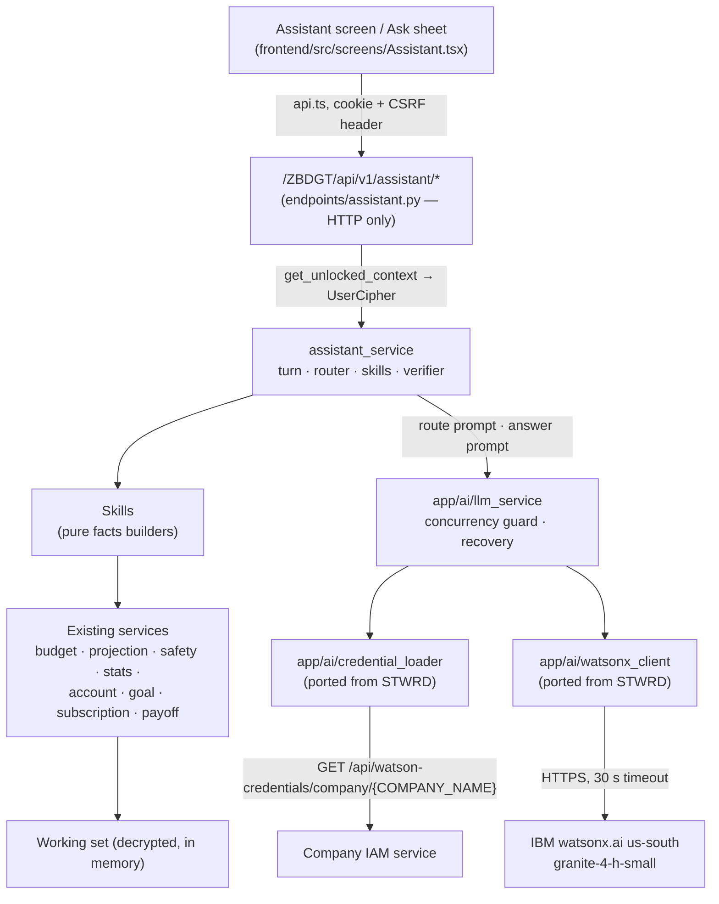
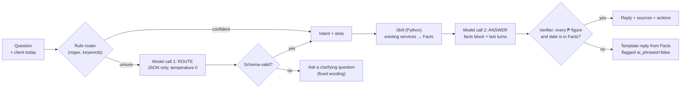
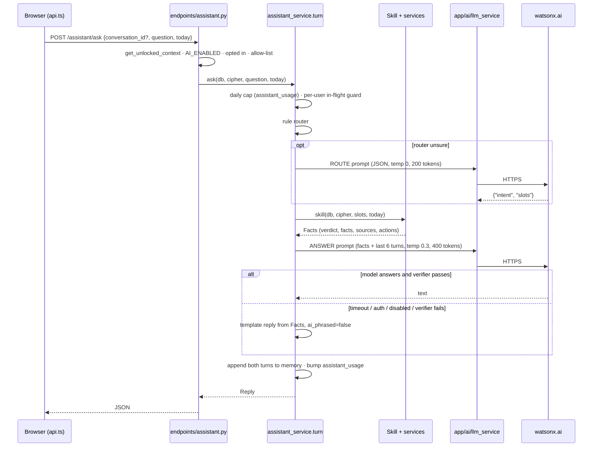

# AI companion — Architecture

Numbered §1–§12. Code comments should cite them as `AI-ARCH §n`, alongside the
`misc/ARCHITECTURE.md` sections they touch. Feature IDs (`AI-xx`) are in
[FEATURES.md](FEATURES.md).

---

## 1. What it is, and what it is not

**It is** a question-and-answer companion over the signed-in user's own
budget. It answers in plain language, with figures ZBDGT has already
computed, and says what it based the answer on.

**It is not:**

- A financial adviser. It reports the user's own numbers and the app's own
  rules (budget, allowance, emergency-fund targets, payoff order). It never
  recommends a stock, a fund, a loan product or a bank. This is also what the
  app's own safety rules require of an assistant.
- A second calculator. Every figure comes from an existing service; the model
  never adds, subtracts, averages or projects.
- A writer. It cannot post, edit or delete anything (§8).
- A general chatbot. Off-topic questions get a short, fixed reply.

---

## 2. The layers



It sits at the **service** level, where plaintext already lives. It does not
touch `app/db/repositories/` or anything under `app/core/crypto/`, so
invariant 1 (encryption in exactly one layer) is untouched: the assistant
reads decrypted views from services exactly as an endpoint does.

### New files (proposed)

| Path | Role |
|---|---|
| `app/ai/__init__.py` | Nothing imported at package import time |
| `app/ai/credential_loader.py` | STWRD's `AutoReloadCredentialLoader`, `Config.X` → `settings.X` |
| `app/ai/watsonx_client.py` | STWRD's `WatsonxChatModel`, unchanged apart from messages (§3) |
| `app/ai/llm_service.py` | STWRD's `LLMService`, `ConcurrencyGuard`, `get_llm_service()`, `health()` minus the table check |
| `app/services/assistant_service/__init__.py` | Public API: `ask()`, `conversation()`, `forget()` |
| `app/services/assistant_service/turn.py` | One turn end to end (§9) |
| `app/services/assistant_service/router.py` | Question → `Intent` (model + rule fallback) |
| `app/services/assistant_service/skills/*.py` | One module per skill; each returns a `Facts` |
| `app/services/assistant_service/prompts.py` | The two prompts, versioned |
| `app/services/assistant_service/verifier.py` | Checks every figure in a reply against the facts |
| `app/services/assistant_service/memory.py` | Per-user in-memory conversations, dropped with the DEK |
| `app/core/utils/affordability.py` | The pure "can I buy this" rules (§5.3) |
| `app/api/v1/endpoints/assistant.py` | Routes (§10) |
| `frontend/src/screens/Assistant.tsx`, `components/assistant/*` | UI (§11) |
| `scripts/ai_health.py`, `scripts/ai_eval.py` | CLI health check, golden-question evaluation |

---

## 3. The model and the keys — ported from STWRD

STWRD (`D:\Shared Files\STWRD_UPDATED`) got these three files from DMS, which
got them from QUOT, and QUOT runs on the same IIS host as ZBDGT. They carry
three apps' worth of fixes, so they are **copied, not rewritten**.

### How the key is obtained (unchanged)

1. `get_llm_service()` refuses unless `AI_ENABLED` is true. While false,
   nothing is imported, no thread starts, IAM is never called.
2. On the first question, `AutoReloadCredentialLoader` is built (it starts one
   daemon thread, `CredentialReloadWorker`).
3. `GET {IAM_MANAGEMENT_URL}/api/watson-credentials/company/{COMPANY_NAME}`
   returns `{success, data: {api_key, project_id, ibm_cloud_url, expired,
   status, expiration_date …}}`.
4. The key is tested once against `https://iam.cloud.ibm.com/identity/token`.
   An IAM-marked-expired key that IBM still accepts is used (IAM's expiry
   fields go stale); one IBM rejects is remembered as bad for
   `CREDENTIAL_CACHE_TTL` instead of being retried.
5. Credentials are cached in process memory for `CREDENTIAL_CACHE_TTL`
   (300 s). One `APIClient` + `ModelInference` per model/params pair, built
   once.
6. An auth error during a call drops the cached model, queues a reload, and
   retries (`invoke_with_recovery`). A timeout is **never** retried.
7. Results are **not** posted back to IAM (`IAM_REPORT_TEST_STATUS=false`),
   as in DMS and STWRD — the IAM record is shared and ZBDGT should not be a
   second writer to it.

### What changes in the port

| STWRD | ZBDGT |
|---|---|
| `from config import Config`, `os.getenv` | fields on `app/core/config.py` `Settings` (pydantic) |
| `WATSONX_ENABLED` | `AI_ENABLED` (same meaning; one name for the whole feature) |
| `_check_tables()` in `health()` | removed — no AI tables in A1 |
| Flask `session` for the user | `UserCipher.user_id` from `get_unlocked_context` |
| Logs `usage=%s` | logs `prompt_tokens=`, `completion_tokens=`, `elapsed_ms=` as plain ints (they pass the redaction filter) |
| `api_key` in the credentials dict | same, but add `api_key|apikey` to the named-secret pattern in `app/core/logging_config.py` so a traceback that prints the dict is redacted |

### Settings (proposed `.env` block)

Copy the IAM values from STWRD's `.env` (which copied them from DMS). **Nothing
here is a secret**: the watsonx key comes from IAM at runtime and exists only
in process memory.

```ini
# --- AI companion (misc/AI) ---
AI_ENABLED=false                 # kill switch; false = nothing loads
COMPANY_NAME=                    # same value as STWRD / DMS (README Q1, decided)
IAM_MANAGEMENT_URL=
CREDENTIAL_CACHE_TTL=300
IAM_MAX_RETRIES=3
IAM_RETRY_DELAY=5
IAM_REPORT_TEST_STATUS=false

WATSONX_URL=https://us-south.ml.cloud.ibm.com
WATSONX_CHAT_MODEL=ibm/granite-4-h-small
WATSONX_TOP_P=0.9
WATSONX_TIMEOUT=30
WATSONX_MAX_RETRIES=3

AI_MAX_CONCURRENT_PER_USER=1
AI_MAX_CONCURRENT_CALLS=3        # one uvicorn worker (invariant 7) - keep low
AI_MAX_QUESTIONS_PER_DAY=100
AI_ALLOWED_USER_IDS=             # pilot list; blank = every opted-in user
AI_REPLY_LANGUAGE=en             # en | match (reply in the question's language,
                                 # Taglish included) - match only after the A2 gate
```

`AI_ENABLED=true` with a blank `IAM_MANAGEMENT_URL` or `COMPANY_NAME` should
fail config validation at startup, the same way a bad master key does — but
it must **not** block startup when `AI_ENABLED=false`.

### Dependencies

`ibm-watsonx-ai`, `httpx`, `requests` — pinned to what the shared QUOT venv
already has (README Q3: read off the server in A1). Imported only inside `app/ai/`, only when a question is
asked, so the app runs without them installed while `AI_ENABLED=false`, and
tests never import them (they use a fake model, §12).

---

## 4. Where the AI is, and where it is not

| Place | AI? | Why |
|---|---|---|
| Assistant screen and the Ask sheet | Yes | The feature |
| "Explain this" on Home's budget card, an alert, the monthly review | Yes (A4) | Opens the assistant with that context named |
| Transaction add sheet | No model call | Category guessing stays with merchant memory (TXN-24): deterministic, instant, private |
| Imports, backups, restore, rotation, admin | Never | Nothing to ask; not worth the exposure |
| Anything that writes | Never | §8 |
| Sign-in, lock screen, email | Never | No key, no user context |

---

## 5. How a question is answered

### 5.1 Two model calls around a deterministic middle



- **ROUTE** returns `{"intent": "...", "slots": {...}}` — nothing else.
  Slots are typed and validated by pydantic: `amount` is parsed with
  `money.py` (two places, `Decimal`), dates must fall in a sane window,
  `category` / `account` are matched against the user's own names
  server-side and replaced by ids. The model never sees ids.
- **SKILL** is ordinary Python calling existing services with the user's
  `UserCipher`. It produces a `Facts` object: a verdict (where the skill has
  one), a list of labelled, **pre-formatted** facts (`"₱4,210.00 left in the
  budget until 15 Oct"`), the sources used, and suggested actions.
- **ANSWER** gets the facts block and the last few turns and writes 1–4
  sentences. It is told to copy figures exactly as written.
- **VERIFIER** extracts every money amount, percentage and date from the reply
  and checks each one appears in the facts. One unknown figure → the reply is
  thrown away and a template built from the facts is shown instead. That
  makes a hallucinated number impossible to display, not just unlikely.

A simple question the rule router is sure of ("how much is left in my
budget?") costs one model call. With the model off, broken or slow, every
skill still answers from its template (§12).

### 5.2 Skills (A2–A4)

Each skill is a function `(db, cipher, slots, today) -> Facts` and reads only
existing services. The figure it reports is always the one the matching screen
shows, so the assistant can never disagree with the app.

| Skill | Answers | Reads |
|---|---|---|
| `budget_status` | How much is left? Am I on track? Daily allowance? | `budget_service.status`, `standalone_alerts` |
| `spending` | Where did my money go? How much on food in Sept? vs last month? | `stats_service.overview`, `category_shares`, `previous_range` |
| `review` | How was last month? | `stats_service.review` |
| `cash` | How much cash do I have? Net worth? | `account_service.list_accounts`, `cash_on_hand`, `net_worth` |
| `upcoming` | What bills are due before payday / this week? | `projection_service.project`, `subscription_service.reminders`, card views |
| `card` | What do I owe on my card? When is it due? Limit left? | `account_service` credit views (`owed_with_plans`, bills, `due_now`) |
| `afford` | Can I buy X for ₱Y? Should I pay cash or installment? | §5.3 |
| `goals` | How is my Japan fund? How much per month to reach it? | `goal_service.list_goals`, `monthly_need` |
| `emergency` | Is my emergency fund enough? | `safety_service.advice` |
| `subscriptions` | What am I subscribed to? What did cancelling save? | `subscription_service.overview`, `detected` |
| `payoff` | Which debt first? When will I be debt-free? | `payoff_service.plan` |
| `find` | When did I last pay Meralco? How much at Jollibee this month? | `transaction_service.list_transactions`, `merchants` |
| `how_to` | How do I add a card bill? What is "set aside"? | A static, hand-written help index (no user data) |
| `off_topic` | Anything else | Fixed reply, no model call |

### 5.3 Affordability — the headline feature

`app/core/utils/affordability.py` is **pure** (plain inputs, no db), like
`emergency.py`, `interest.py` and `payoff.py`, and tested directly. The
`afford` skill gathers its inputs from services:

| Input | From |
|---|---|
| Price, when (today by default), how (cash / a named account / card / installment months) | Slots |
| Left in the current budget period, daily allowance, days left | `budget_service.status` |
| Cash on hand **available** (set-aside money already excluded) | `account_service.cash_on_hand` |
| Money going out before the next income, and the lowest point of cash in the window | `projection_service.project(months=3)` — the Months ahead line |
| Next expected income date | projection income items, else `goal_service.payday` |
| Emergency fund cover and target | `safety_service.advice` |
| Goals' required per month | `goal_service.list_goals` |
| Card limit left, next statement and due date | credit views; for installments, `recurring_service.trial` → `projection_service.project(trial=...)` |

The rules return a **verdict** and **reasons**, never prose:

| Verdict | Rule (all thresholds in one table in the module) |
|---|---|
| `yes` | Fits in what is left of the budget period **and** the projected lowest cash point stays above zero **and** the emergency fund is not touched |
| `yes_over_budget` | Cash stays positive but the budget period goes over — say by how much and what the daily allowance becomes |
| `tight` | Cash stays positive only by dipping into set-aside / emergency money, or the lowest point falls under one week of essentials |
| `wait` | Cash goes negative before the next income, but not after it — report the first date it fits |
| `no` | Cash goes negative even after the next income, or card limit left is less than the price |

Alternatives are computed, not invented: the earliest date it fits
(`wait`), the monthly cost and the new lowest point as an installment (a
what-if, REC-27 machinery, writes nothing), and which goal could cover it and
by how much that goal's date slips.

The model is told the verdict is final — it explains it, it never overrules
it — and it never phrases it as advice ("you should…"); it states what the
numbers show and what each option does.

---

## 6. The privacy boundary

ZBDGT encrypts every financial field because the database is not trusted.
The assistant is the **only** place decrypted data is sent outside the
process, to IBM watsonx.ai in us-south, through a key the company controls.
So:

**Opt-in, per user.** A new preference `assistant` (server-side, in the
encrypted profile like `haptics` — never browser storage) defaults to off.
Turning it on shows a one-screen disclosure: what is sent, to whom, that it
is not stored by ZBDGT, and a switch to turn it off. The admin kill switch
is `AI_ENABLED`; a pilot allow-list is `AI_ALLOWED_USER_IDS`.

**What reaches the model:**

| Sent | Never sent |
|---|---|
| The question as typed | Email, name, user id, any row id |
| The facts block: pre-formatted figures, dates, verdicts | Raw transactions, payload JSON, balances per day |
| Category names, account names and goal names **as the user named them** | Transaction descriptions and notes (A1–A3). `find` sends merchant names only for the rows it reports, from A4 (allowed, README Q2) |
| The last 6 turns of this conversation | Anything from another user, a backup, an attachment, a receipt |

Account names can identify a bank ("BPI Savings"). A5 adds an optional
**masking** preference: accounts are sent as "your savings account (1)" and
names restored in the reply server-side.

**Hard rules** (tests enforce them, §12):

- A skill takes a `UserCipher` and nothing else identifying the user — there
  is no way to ask about another user (invariant 6 carries over).
- The prompt text and the reply text are **never logged**, DEBUG or not.
  Logs get intent, skill, verdict, token counts, `elapsed_ms`, and whether the
  verifier passed.
- No content goes into `audit_log`. One audit action,
  `ASSISTANT_ENABLED` / `ASSISTANT_DISABLED`, records the opt-in change.
- Questions and answers are never put in URLs (IIS logs query strings); they
  are POST bodies.

---

## 7. Conversations and storage

**A1–A5: memory only.** `assistant_service/memory.py` keeps, per user, at
most a few conversations of at most ~20 turns each, in process memory. It
registers with the session keyring's drop notification — the same hook the
working set uses — so a lock, sign-out, idle expiry or sweep clears it. IIS
stopping the process clears it too. That keeps invariant 10 intact on the
browser side and adds nothing to the database.

Consequence: history does not survive a lock. That is the same promise the
rest of the app makes about decrypted data, and it is the right default for a
first release.

**A6 (optional): encrypted history.** If saved history is wanted, it becomes a
**Shape B** table, `assistant_threads`, one row per conversation, payload
`{title, turns: [...]}` sealed under the user's DEK through a new
`EncryptedRepository` subclass (the two-step insert and AAD come for free). It
then has to be added to `backup_service/references.py` ORDER, to
`rotation_repository.py` (DEK rotation re-seals it), to account deletion, and
to `verify_integrity.py`. That is enough surface that it is its own phase and
its own decision.

**Usage metering (A1).** A small **Shape A** table, `assistant_usage`: `id,
user_id, day, questions, prompt_tokens, completion_tokens, model_calls,
fallbacks`. Counts only — no content, nothing encrypted needed — enough for
the daily cap and an admin line on the Admin screen. One Alembic migration.

---

## 8. Proposals, never writes

The assistant can end a reply with **actions**, which are data, not side
effects:

| Action | What the client does |
|---|---|
| `open_screen` (`/budget`, `/goals/7`, `/projection` …) | Navigates |
| `draft_transaction` `{type, amount, category_id, account_id, date, note}` | Opens `TransactionSheet` pre-filled. The user saves through the normal path, which calls `afterWrite(...MONEY)` |
| `draft_goal` / `draft_budget` | Opens the ordinary goal / budget editor pre-filled |
| `try_installment` | Opens the What-if (REC-27) with the purchase filled in |

The server builds action payloads from validated slots and the user's own
ids; the model only chooses *which* action fits, from the list the skill
offers. No endpoint under `/assistant` writes financial data, so
`writePaths.test.ts` exempts `screens/Assistant.tsx` the way it exempts
`screens/Payoff.tsx`.

---

## 9. A turn, end to end



The facts are always returned alongside the reply, so the UI can show "Based
on: budget (1–15 Oct), cash on hand, Months ahead" and the figures behind the
sentence, whether or not the model phrased it.

---

## 10. API

All under `/ZBDGT/api/v1/assistant`, all depending on
`get_unlocked_context` (a locked session gets the usual `SESSION_LOCKED`),
errors as RFC 7807 with stable codes.

| Method | Path | Does |
|---|---|---|
| `GET` | `/status` | `{enabled, opted_in, questions_left_today, suggestions[]}` — never loads credentials |
| `POST` | `/ask` | One turn; body `{conversation_id?, question, today, context?}` |
| `GET` | `/conversations/{id}` | This session's in-memory turns (404 once dropped) |
| `DELETE` | `/conversations/{id}` | Forget one now |
| `GET` | `/health` | Admin only — STWRD's `health()`: credentials loaded and accepted, model replies, ms each |

`context` (A4) names where the question was asked from — `{"screen":
"budget"}`, `{"alert": "card_due", "account_id": 3}` — and the server
re-reads that object itself; nothing the browser sends is trusted as a
figure (STWRD decision 2).

New problem codes: `ASSISTANT_DISABLED` (503), `ASSISTANT_NOT_OPTED_IN`
(403), `ASSISTANT_BUSY` (429, a question already in flight / process cap),
`ASSISTANT_DAILY_LIMIT` (429), `ASSISTANT_QUESTION_TOO_LONG` (422, >500
chars). A model failure is **not** an error: it is a 200 with
`ai_phrased: false`.

---

## 11. Frontend

- **Entry points.** The tab bar stays Home · Accounts · [+] · Calendar ·
  More. The assistant is a row on More (`/assistant`) and, once opted in, a
  small "Ask" tile on Home. A4 adds "Explain" links on the budget card,
  alerts and the monthly review.
- **Screen.** A neo-brutalist chat: each reply is a card (`shadow-card`,
  `rounded-card`) with the sentence, a collapsible "Based on" list of facts in
  `.num`, and action buttons (`.press`). Suggested questions as chips when
  empty. The verdict of an `afford` answer is a label using `ok` / `warn` /
  `danger` — those tokens mean money state, which is exactly what a verdict
  is. No new UI dependency; tokens only; mobile-first at 390 px.
- **State.** Conversation turns live in a small store, **not** react-query
  and never persisted. It is cleared in the App.tsx lock effect beside
  `queryClient.clear()` and `resetLedger()`. `/status` is a react-query key
  in `queryKeys.ts` with a short stale time.
- **No streaming.** A typing indicator covers the wait (DMS/STWRD decision 6).
  uvicorn could stream, but the verifier needs the whole reply before any of
  it can be shown.
- **Haptics.** Reply arrival calls `buzz()` like any other completion.

---

## 12. Capacity, failure and testing

*As built (A2, 2026-09-30):* `/assistant/status` also returns `opted_in`,
`reply_language` and `suggestions`. The conversation store invalidates only
`['assistant']`: a question moves no figure, so the ledger's version is left
alone. The first model call after a process start is about 8 s (key fetch and
client build), measured apart from p95 by `scripts/ai_eval.py`. The router
sends any question that mentions a card to the card skill.


### Capacity

ZBDGT runs **one uvicorn worker** (invariant 7). Sync endpoints run in its
thread pool, so a 30 s model wait blocks a thread, not the loop — but it is
still one process for every user. Controls, all from STWRD:

| Control | Value |
|---|---|
| `WATSONX_TIMEOUT` applied to the SDK's HTTP client | 30 s |
| In-flight questions per user | 1 |
| Model calls in the process | 3 |
| Questions per user per day | 100 |
| Question length | 500 characters |
| Answer tokens | ROUTE 200, ANSWER 400 |

DMS measured this model at p50 ≈ 0.85 s, p95 ≈ 3.6 s for ~2.5k-token
prompts. A facts block is far smaller (~300–800 tokens), so two calls should
stay well inside the timeout. A1 measures it again from this host.

### Failure modes

| Failure | What the user sees |
|---|---|
| `AI_ENABLED=false` | No entry points; `/status` says disabled |
| Not opted in | The opt-in card instead of the chat |
| IAM down / key rejected | Template answers from the skill, marked "Answered without AI"; one reload is tried first |
| watsonx timeout | Same template answer. The question is never lost |
| Router returns junk | Clarifying question with suggestion chips |
| Verifier rejects a reply | Template answer (logged as `verifier_failed=1`, content not logged) |
| Session locked mid-question | `SESSION_LOCKED` as everywhere; the conversation is gone with the key |
| Daily cap | 429 with a plain sentence |

### Tests

- **Unit, pure:** `affordability.py` verdict table (every row and boundary),
  the verifier (amount formats: `₱1,234.50`, `1234.5`, `1.2k`, `PHP 1,234`;
  dates), the rule router.
- **Skills:** against the in-memory SQLite fixtures the repository tests
  already use; each skill's figure must equal the matching endpoint's figure
  for the same fixture — the "never disagrees with the screen" test.
- **Turn:** with a `FakeLLM` injected into `LLMService` — fixed replies,
  a reply with an invented figure (must fall back), a timeout, an auth error
  then success. The watsonx SDK is never imported in tests.
- **Security-marked:** no prompt or reply text appears in any log record
  (capture handler); memory is empty after `keyring.drop()`; a skill cannot
  be called for another user; `/assistant/*` refuses a locked session;
  nothing under `/assistant` writes a Shape B row.
- **Evaluation (`scripts/ai_eval.py`, real model, run by hand):** ~60 golden
  questions against a fixture user with known figures. Reports router
  accuracy, verifier pass rate, and latency. Each phase's gate is stated in
  [PHASES.md](PHASES.md).
- **Frontend:** vitest for the assistant store being cleared on lock, and
  `writePaths.test.ts` updated for the exemption.
