# BUDGET APP — Architecture at a Glance

> The visual tour. [ARCHITECTURE.md](ARCHITECTURE.md) is the same system in
> detail; [phases.md](phases.md) is the order it gets built in;
> [FEATURES.md](FEATURES.md) is the feature-by-feature scope list.

**Personal Budget & Spending Tracker**
FastAPI · SQL Server (`ZBDGT` schema) · React 19 + Vite · AES-256-GCM at rest

---

## 1. What the system does

You set a budget for a period. You log what you spend. The app answers one
question better than any other: **how much can I still spend today?**

It is a web reimplementation of the iOS app *Budget App — Spending Tracker*,
with two deliberate differences: it runs on a shared company database, so
**every field of financial data is encrypted before it leaves the process**;
and it is a mobile-first React PWA rather than a native app.

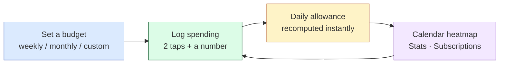

Two kinds of entry the app writes for you, rather than asking you to type
them, both as ordinary rows you can see and delete:

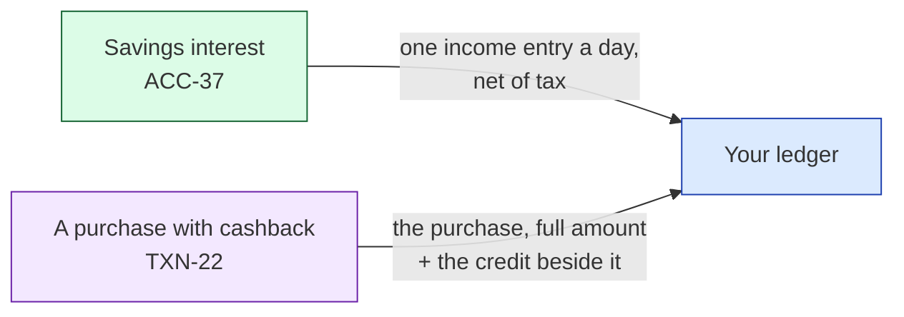

Neither is a special kind of transaction: interest is income filed in the
category you chose, and cashback is income joined to its purchase the way a
transfer's two legs are joined. Anything that reads the ledger — stats, the
budget, the calendar — sees them without knowing they exist.

---

## 2. How a request reaches the code

One process serves the API, the SPA shell, and the built React bundle. There is
no separate frontend service to deploy, and no Node on the server.

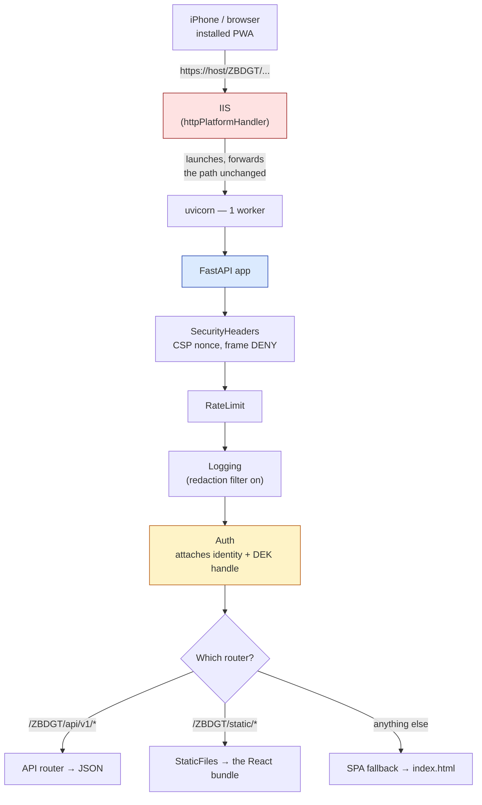

Four things worth knowing:

- **One worker — QUOT runs two, this app can't.** The decrypted working set and
  the session keys live in process memory. A second worker would hold its own
  copy, serve stale numbers after a write landed on the other, and see users as
  locked who had just unlocked. One worker is correct here.
- **The SPA fallback is a catch-all.** React Router owns the URL space, so any
  unmatched path returns `index.html` and lets the client route it.
- **`AuthMiddleware` does not block.** It attaches identity when a token is
  valid and lets everything through; the `get_current_user` dependency enforces.
  Same deliberate split as QUOT — a failed login still gets audited.
- **The app refuses to boot without a valid master key.** Not a warning. A
  budget app that quietly starts writing plaintext is worse than one that stops.

---

## 3. The layers

Every feature is the same four steps, in the same direction, with encryption
sitting on exactly one boundary.

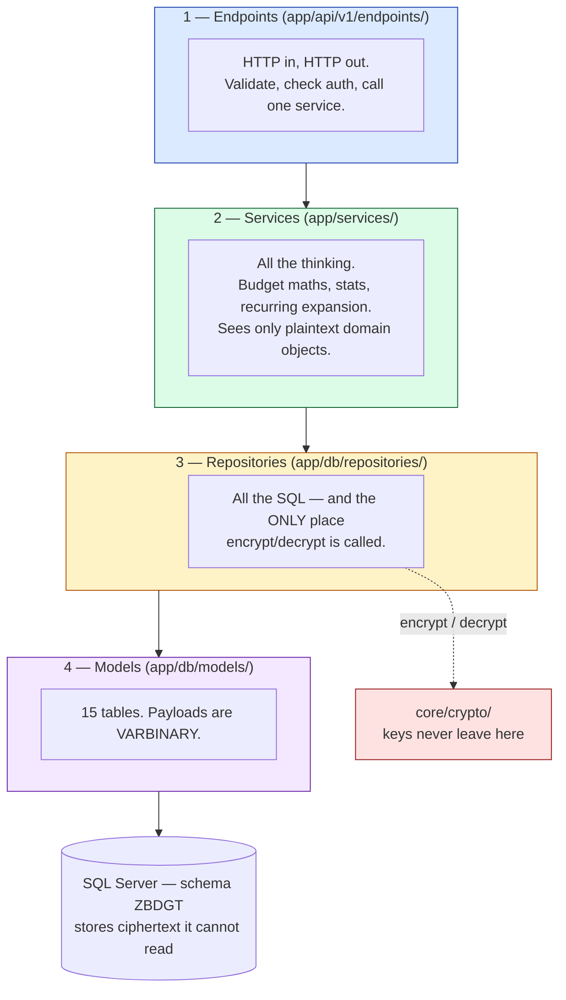

**The rule that keeps this honest:** a service author never encrypts anything.
Repositories return fully decrypted objects and accept fully populated ones.
Forgetting to encrypt one field, in one place, once, is exactly the failure this
boundary is designed to make impossible.

**Where to look when you need to change something:**

| If you need to change… | Go to |
|---|---|
| A URL, request shape, or response shape | `app/api/v1/endpoints/` |
| Budget maths, a stat, recurring logic | `app/services/` |
| A query, or how something is stored | `app/db/repositories/` |
| A field inside an encrypted payload | the payload schema in `app/api/v1/schemas/` |
| Anything about keys or ciphers | `app/core/crypto/` — and read §5 of ARCHITECTURE.md first |
| A screen | `frontend/src/` — then rebuild and commit `dist/` |

---

## 4. The data model

Fifteen tables in two shapes. Four are operational and readable; eleven hold a
single encrypted blob each.

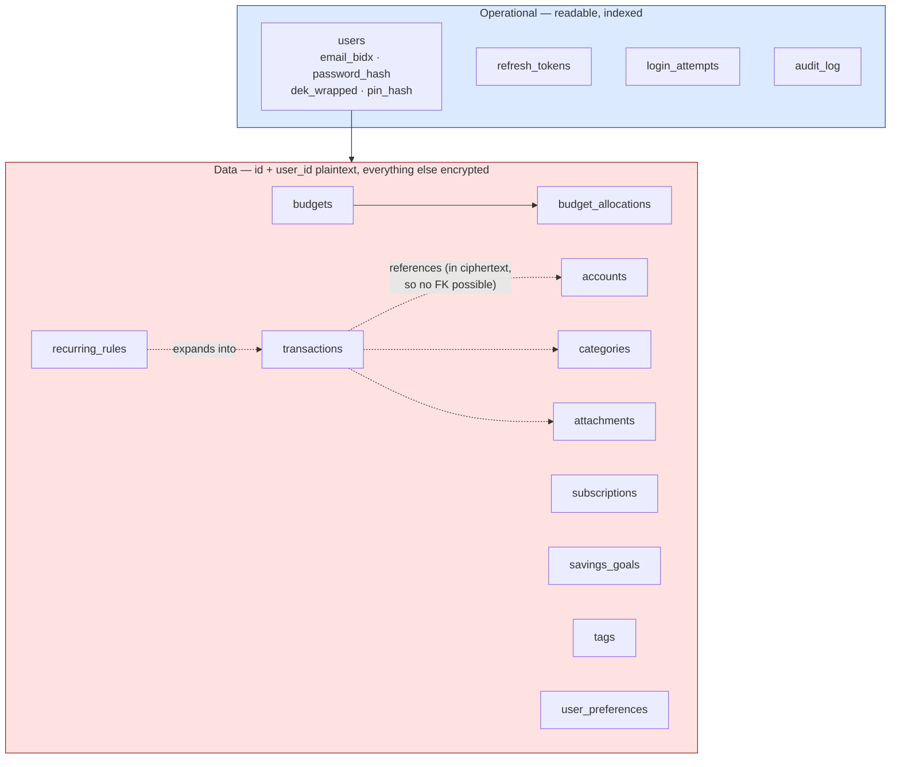

A `transactions` row as the DBA sees it, versus as the app sees it:

```
WHAT SQL SERVER STORES                 WHAT THE APP DECRYPTS IT TO
──────────────────────                 ───────────────────────────
id          4821                       {
user_id     1                            "txn_date":   "2026-09-08",
key_version 1                            "type":       "expense",
payload     0x01 01 9f3a...              "amount":     "3500.00",
            (a 214-byte blob)            "account_id": 3,
is_deleted  0                            "merchant":   "SM Supermarket",
row_created 2026-09-08 14:22:07          "splits": [
row_updated 2026-09-08 14:22:07            {"category_id": 11,
                                            "amount": "2800.00"},
                                           {"category_id": 19,
                                            "amount":  "700.00"}
                                         ],
                                         "tag_ids":    [2, 7]
                                       }
```

Note the dotted arrows above: those relationships are **real but unenforceable**.
`category_id` is inside the ciphertext, so no foreign key can exist. Integrity is
the service layer's job, and `scripts/verify_integrity.py` checks for drift.

`row_created` is the *insert* timestamp, not the transaction date. It leaks when
you used the app — unavoidable — while `txn_date`, which is your actual financial
timeline, stays encrypted.

---

## 5. Flow A — logging an expense

The core interaction. Everything is tuned so this takes two taps and a number.

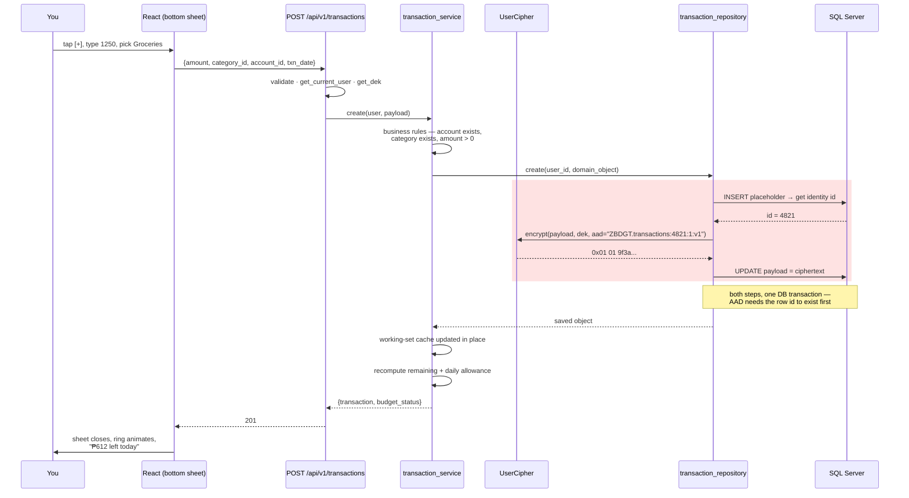

The response carries the recomputed budget status, so the home screen updates
without a second round trip. That is what makes it feel native.

---

## 6. Flow B — opening the app (the decryption path)

This is where the encryption design either pays off or hurts, so it is worth
following closely.

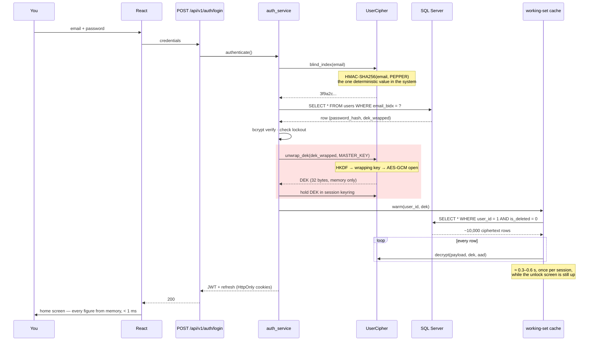

**The trade, stated plainly.** Because dates and category IDs are encrypted too,
SQL cannot filter or sum anything — so the app loads your rows once and does all
arithmetic in memory. One slow moment at login buys instant everything
afterwards. At personal scale this is comfortable. §5.7 of ARCHITECTURE.md has
the escape hatch if it ever stops being.

---

## 7. Flow C — where the daily allowance number comes from

The number the whole app exists to display. Pure Python over the warm cache.

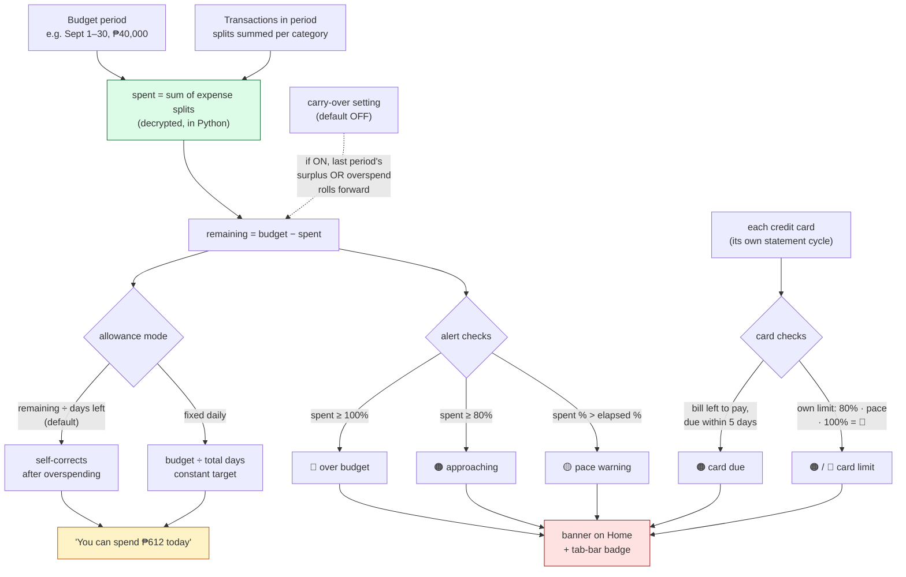

**Alerts are computed here, in your session, from data already decrypted** —
never by a background service. That is why there is no web push: a push sender
would have to know you are over budget while you are not using the app, which
means holding your keys outside your session. Same information, no new exposure.

The default mode is self-correcting: overspend today and tomorrow's allowance
drops automatically. That is the behaviour the iOS app has, and it is the reason
the number changes behaviour rather than just reporting on it.

Recurring rules feed this too — `recurring_service` expands rules into real
transactions on their due date, so a ₱1,500 subscription reduces your allowance
on the day it charges, not as a surprise at month end.

The same rules also look **forward**. `projection_service` asks `recurring_service`
for every occurrence in the coming months and lays them out as salary in,
committed charges out, the rest of the budget, and cash on hand at each month
end. It also shows each credit card's next statements. It reads and never posts,
so a projected salary cannot turn into a real transaction by accident
(ARCHITECTURE.md §4.5).

---

## 8. The screens

Bottom tab bar, thumb-reachable, `[+]` centre and raised. Designed at 390 px.
Since 2026-09-15 the tabs are Home · Accounts · [+] · Calendar · More. Since
2026-09-18 the look is neo-brutalist - outlined tiles, hard shadows, mono
figures - in four palettes (classic, candy, lime, mono), each light and dark.

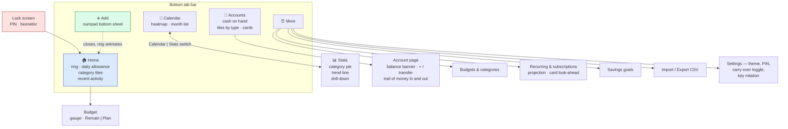

The add sheet opens with the amount focused and the numpad already up. No
keyboard, no tap-to-focus, no scrolling to a submit button.

---

## 9. How React gets to the server

The server has no Node and no npm, permanently. The build happens on your
machine and the output is committed.

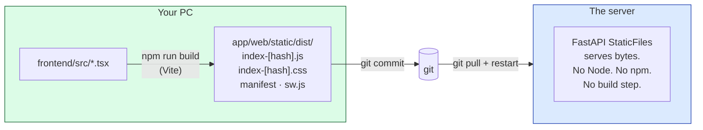

`dist/` is committed on purpose — `.gitignore` says so at the line where it
would otherwise be excluded. Because Vite hashes filenames, the app reads
`dist/.vite/manifest.json` at startup and injects the current names into the
Jinja shell, so `index.html` always points at the bundle that is really there.

Development is different: Vite dev server on `:5173` with hot reload, proxying
API calls to uvicorn on `:8000`. That is the only reason `CORS_ORIGINS` exists —
in production both come from one origin.

---

## 10. What is protected, and what is not

Worth being exact, because "encrypted" is often claimed more broadly than it is
true.

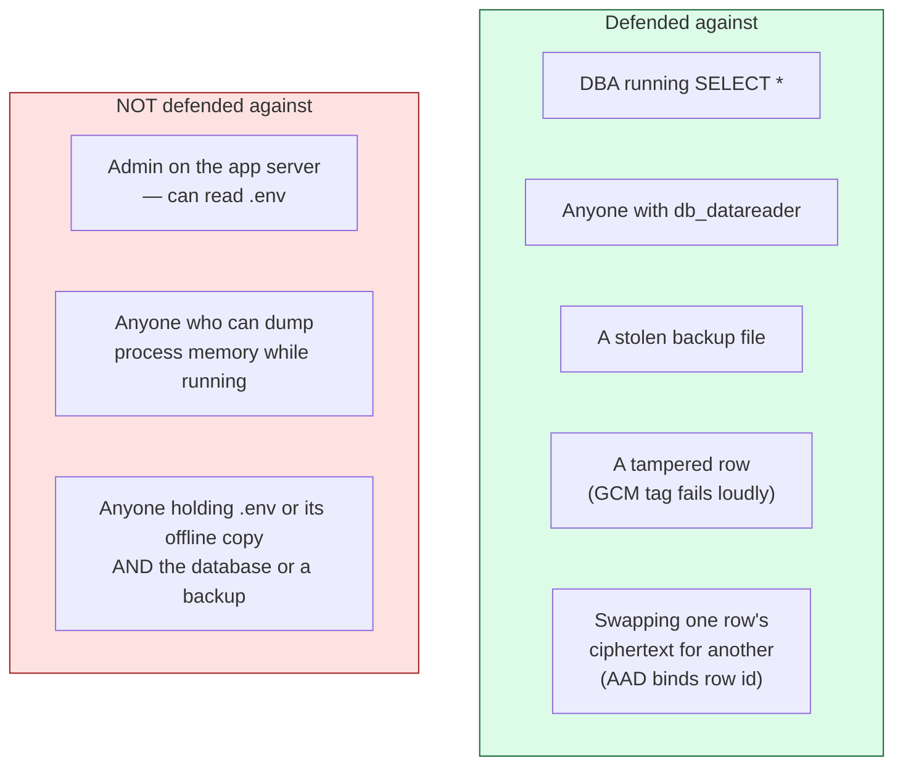

**`.env` is the one key, and its offline copy is the insurance.** There is no
recovery phrase (removed 2026-09-14): every user's DEK is wrapped by the master
key alone. The server owner keeps a copy of the whole `.env` off the server, in
at least two places, apart from the backup files, and refreshes it whenever a
key changes. A forgotten password is reset by an emailed link, which touches no data.

The trade is concentration. Users carry nothing, and the owner carries all of
it: losing `.env` and every copy loses every account at once, and whoever holds
`.env` plus the database can read everything.

The honest summary: this defends your data from **the database and everyone with
access to it**, which is precisely the risk you took on by using the company
server for personal finances. It does **not** defend against someone with
administrative control of the machine doing the decrypting. If the same team
administers both, this buys less than it appears to.

On key loss: **there is one way in** — `BUDGET_MASTER_KEY` in `.env`. Keep the
offline copy current and check it against the server by fingerprint. Losing
`.env` with a good copy is a five-minute restore. Losing it without one is
permanent, for everyone, and no support ticket will change that.

---

## 11. Backup — so the database is not your only copy

The company database is shared infrastructure you do not control. The app
therefore owns a complete, portable, **still-encrypted** copy of itself.

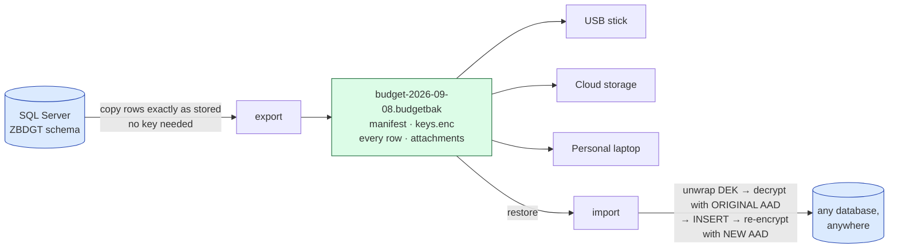

**Why only the import re-encrypts.** AAD binds every ciphertext to its row `id` —
the thing that stops a DBA swapping your ₱5 coffee over your ₱50,000 rent. So
rows can't simply be reloaded into a new database, which assigns new ids. The
export copies each row exactly as stored, along with its original `id`; the
import uses that to rebuild the original AAD, decrypts, inserts, and re-encrypts
under the new id. **Writing a backup decrypts nothing and needs no key.**

**When.** Five minutes after your last change, and at login if the newest backup
is over a day old — never at a fixed time, because IIS stops the app after 20
idle minutes and a 02:00 job would rarely fire. Data only changes while the app
is in use, so nothing is missed.

The file carries the wrapped DEK, so it is **standalone** wherever the master key
exists — a new server, an empty database, and the offline `.env` copy bring
everything back. Keep the file and that copy apart: together they are the data.

Safe to put anywhere: it is ciphertext throughout. There is deliberately **no
plaintext full archive**; per-transaction CSV export remains for Excel, and that
stays the single warned opening in the encryption boundary.

> The test that makes it real: **export → restore into an empty database →
> export again → the two must match.** Until that passes, you have a file.

---

## 12. Multiple users

Supported — and it was nearly free, because every table has carried `user_id`
and a per-user key since Phase 1.

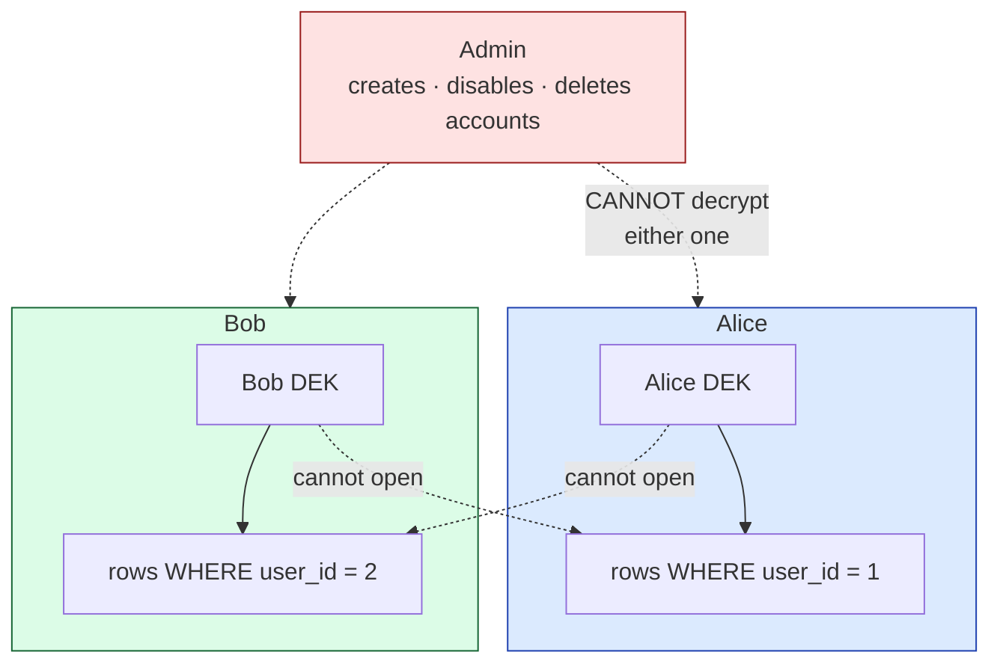

Bob cannot read Alice's data — **not by policy, by cryptography**. Their DEKs
are unrelated keys. Which leads to the property worth understanding before you
add a second user:

> **No administrator can read anyone's data in the app**, or reset anyone's
> password — a reset link goes only to the account's own email, so the mailbox
> is what guards it. Outside the app, whoever holds `.env` and the
> database can read everything. If `.env` and every offline copy are lost,
> nobody can help anyone — not you, not the DBA. Correct behaviour here, not a
> gap.

**Shared budgets are still out.** Two people with *separate* data is a config
flag; two people editing *one* budget needs a per-budget key wrapped to each
member, which needs public-key crypto (an X25519 keypair per user) because Alice
cannot wrap a key to Bob without knowing his DEK. Roughly 2–3 weeks, and it
changes the key model rather than extending it. ARCHITECTURE.md §13.4 has the
sketch if you ever want it.

---

## 13. Current state, honestly

Phases 1 and 2 are built (2026-09-11): the crypto core, the database layer and
migration, the frontend shell, and the whole sign-in / lock flow, with 212
passing tests. They also built a 12-word recovery phrase; on 2026-09-14 it was
reversed in favour of an offline `.env` copy, and its code was removed the same day. Schema ZBDGT and its fifteen
tables exist on P8_NOAH_AI. Everything from Phase 3 on is still a decision, not
an observation.

The three things most likely to change:

1. **The performance numbers in §6 are measured, except from the server.**
   Decrypt + parse of 10,000 transactions: 123-140 ms. From the dev PC the
   SQL Server cold load is 2.3 s, nearly all of it the internet link. The
   deciding run is `scripts/benchmark_fetch.py` on the app server; if that
   exceeds ~1.5 s, the bucket-column escape hatch becomes the plan.
2. **The two-step insert in §5** is the least elegant thing in the design. If it
   proves error-prone, bind AAD to a client-generated UUID instead of the
   identity column.
3. **Offline writes are deferred to Phase 9 and may not land at all.** Merging
   offline edits into an encrypted store is genuinely hard. Do not let the PWA
   shell imply a capability that is not there.

Start with [phases.md](phases.md) — its Phase 1 section says what was built,
what was built differently from the plan, and what is left: your first
account (the sign-up screen), and the benchmark run on the server.
