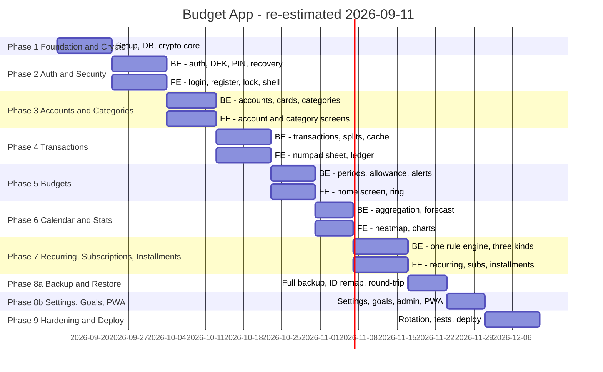

# 🔄 Budget App — Frontend & Backend Simultaneous Development Plan

## 📋 Project Overview
- **Project**: Personal Budget & Spending Tracker (encrypted, mobile-first)
- **Model**: Budget App — Spending Tracker (iOS, id1525179720)
- **Duration**: 13–15 weeks (re-estimated 2026-09-11; was 9–11 when v1 had
  ~100 features — it now has 161)
- **Planned**: Sep 14 – Dec 10, 2026 (88 days), plus ~2 weeks of buffer
- **Built so far**: Phases 1 and 2, both on 2026-09-11 — crypto core, database,
  schema `ZBDGT` created, sign-in / lock / recovery. 212 tests
- **Usable**: after Phase 5 (~Oct 30). Backups start in Phase 8a (~Nov 23);
  until then the company database is your only copy
- **Team**: 1 solo developer
- **Strategy**: backend and frontend developed simultaneously, per feature
- **Storage**: company SQL Server, schema `ZBDGT`, every data field encrypted
- **Frontend**: React 19 + Vite, built locally, bundle committed — no npm on server

> **Scope per phase comes from [FEATURES.md](FEATURES.md).** Feature IDs there
> (TXN-01, BUD-06, …) map onto the tasks below. All scope decisions are settled;
> §13 of that file records what was chosen and why.

> **Phase 1 is not optional and cannot be reordered.** Everything else in this
> plan writes through the crypto layer. Getting it wrong later means decrypting
> and re-encrypting every row you own. Build it first, test it hardest.

---

## 🗺️ Timeline — Backend & Frontend Together



> Task names avoid colons on purpose: Mermaid reads the first colon on a task
> line as the start of its settings, so a name like `BE: Auth` breaks the chart.

---

## 📦 PHASE 0: Access & Prerequisites (before Sep 14 — mostly done)

### 🎯 Objective: Confirm you can actually build this where you intend to

> Nothing in Phase 1 works without these. Settle them FIRST - discovering a
> missing grant in week three costs a lot more than an email now.

```yaml
Database access:
  ✅ Uses QUOT's database login (same server, same database). You
     confirmed it has the rights: CREATE SCHEMA for ZBDGT and
     ZBDGT_VERIFY, and table DDL within them. The first
     `alembic upgrade head` is the proof - if it fails, it fails there.
     If the login's password is ever changed, update both .env files.
  ☐ Confirm the DB collation and that VARBINARY(MAX) is unrestricted

  NOTE: you do NOT need db_owner, and should not ask for it.
  The app never touches another schema.

Fill in .env (still placeholders today):
  ✅ DB_SERVER, DB_NAME, DB_USER, DB_PASSWORD - copied from QUOT's .env
     (same server, same database, same login)
  ☐ DB_SCHEMA=ZBDGT     <- confirmed

IIS (needed at Phase 9, confirm early):
  ✅ IIS application name: ZBDGT (BASE_URL=/ZBDGT, API_PREFIX=/ZBDGT/api/v1)
  ✅ web.config written, following QUOT's (ARCHITECTURE.md S10)
  ☐ Create the IIS application ZBDGT on the same site as QUOT
  ☐ Install requirements into the shared FAST-PYTHON venv. Run
    pip install -r requirements.txt --dry-run FIRST - QUOT uses it too.
  ☐ httpPlatformHandler installed on the host
  ☐ A Python runtime available to the app pool
  ✅ HTTPS: production is https://delca.noahapplication.com/ZBDGT, same host as
     QUOT. SESSION_COOKIE_SECURE=true is correct.
  ☐ (optional) Ask the platform team whether a subdomain such as
    zbdgt.noahapplication.com is easy. It is the only full fix for
    sharing a browser origin with other apps (ARCHITECTURE.md S10.3).

Local machine:
  ✅ Python 3.11.9
  ✅ ODBC Driver 17 for SQL Server
  ✅ Node.js 21.1 - LOCAL ONLY, for building the frontend. Never on the server.
     Works with Vite 6. Upgrade to Node 22 LTS before moving to Vite 7.

★ If the DDL grant is refused:
  The design assumes app-side encryption into tables you control. Without
  CREATE TABLE the project cannot proceed as designed. Fallbacks, worst
  to least bad: (a) ask for a separate database, (b) ask the DBA to run
  scripts/int_tables.sql for you and grant DML only - workable, but every
  future migration becomes a ticket, (c) run SQLite locally and lose the
  shared/backed-up storage that motivated this. Decide before Phase 1.
```

---

## 📦 PHASE 1: Foundation & Cryptographic Core (Sep 14 – Sep 23 · 10 days)

### 🎯 Objective: Project skeleton, database, and a crypto layer you can trust

> **Status 2026-09-11: BUILT, ahead of schedule.** Everything below marked ✅
> exists and is tested: 164 local tests pass, and the SQL Server tests pass
> against P8_NOAH_AI. Schema ZBDGT and its 15 tables were created by
> `alembic upgrade head` on 2026-09-11 (QUOT's login is db_owner there).
> Open: the benchmark taken ON THE SERVER (see the benchmark block below).
> Your account is created through the signup screen in Phase 2 - the script
> is optional (decided 2026-09-11).

### Backend Tasks

```yaml
Project structure:
  ✅ Folder structure matching the QUOT pattern (misc/file_tree.txt)
  ✅ Local .venv (Python 3.11.9), requirements installed
  ✅ .env configured - DB values from QUOT's, secrets generated
  ✅ scripts/generate_keys.py - every secret in one run; --fill writes only
     into EMPTY keys and never overwrites one that is set

Config:
  ✅ app/core/config.py - Pydantic BaseSettings, .env found from any cwd
  ✅ Validator: MASTER_KEY present and exactly 32 bytes decoded
  ✅ Validator: BLIND_INDEX_PEPPER present, 32+ bytes
  ✅ HARD FAIL at import (ConfigurationError) - and the error never quotes
     the rejected value; secrets are SecretStr so no repr shows them
  ✅ Also refused: cipher/nonce/tag changed, AAD binding off, bad retired-key
     list, key version outside 1-255, a DB_SCHEMA that is not an identifier

★ CRYPTO CORE - app/core/crypto/:
  ✅ keyring.py      master key, HKDF per version, retired keys
  ✅ envelope.py     AES-256-GCM, fmt|ver|nonce|ct|tag - header authenticated
  ✅ dek.py          generate / wrap / unwrap / rewrap, bound to user id
  ✅ blind_index.py  HMAC-SHA256, NFKC + trim + lowercase, constant-time
  ✅ session_keys.py in-memory DEKs, zeroed on lock, idle auto-lock enforced
                     SERVER-side, empty keyring = locked (SEC-27)
  ✅ user_cipher.py  one user's DEK; seals/opens rows; cannot return its key;
                     refuses floats anywhere in a payload
  ✅ self_test.py    wrap/unwrap/seal/open at startup, or the app will not start
  ✅ NO caller-supplied nonce anywhere - a test inspects every signature

★ RECOVERY PHRASE (SEC-14):
  ✅ recovery.py - BIP-39 generate / validate / derive (`mnemonic` package)
  ✅ 12 words, 128-bit entropy
  ✅ phrase -> BIP-39 seed -> HKDF("budget:recovery-wrap") -> recovery key
  ✅ Second DEK wrap -> users.dek_wrapped_recovery, created WITH the DEK
     (provisioning.py) - no DEK ever exists without it
  ✅ Checksum + word-list validation; errors name POSITIONS, never words
  ✅ Normalised: NFKD, lowercase, whitespace, accents, "1." numbering, commas
  ✅ Finds the user by the phrase alone - works with .env completely gone

Database:
  ✅ app/db/connection.py (LAZY engine; password never in URL or repr),
     session.py, base.py
  ✅ app/db/types.py - EncryptedPayload refuses to write anything that is not
     a sealed envelope; portable types so tests run on SQLite
  ✅ 15 models - 4 operational + 11 encrypted (shared Shape B mixin)
  ✅ Repositories: EncryptedRepository (the two-step insert, user scoping),
     UserRepository, PreferencesRepository
  ✅ alembic baseline 20260914_0001 - creates schema + all 15 tables;
     downgrade refused
  ✅ scripts/int_tables.sql - GENERATED from the migration
     (scripts/generate_int_tables.py), so the two cannot drift
  ✅ Schema checked at startup; /health reports it
  ✅ `alembic upgrade head` against P8_NOAH_AI - done 2026-09-11, schema ZBDGT
     created, revision 20260914_0001 (head). SQL Server 2019 (15.0),
     collation SQL_Latin1_General_CP1_CI_AS

App shell + proof:
  ✅ app/main.py - lifespan, middleware (CORS dev-only, SecurityHeaders), /health
  ✅ Logging with REDACTION FILTER attached to every handler before it exists;
     uvicorn's own handlers re-routed through it, query strings stripped
  ✅ app/core/exceptions.py - hierarchy + RFC 7807 problem+json
  ✅ DecryptionError never returns detail (row id to the log, a ref to the client)
  ✅ scripts/bootstrap_user.py - written, tested through its service
     OPTIONAL: your account is created through the Phase 2 signup screen
     (same create_account underneath). The script stays as the server-side
     fallback - signup screen broken, or registration code lost
  ✅ scripts/decrypt_query.py - written (useful once your account exists)
  ✅ scripts/benchmark_fetch.py - the READ-ONLY go/no-go benchmark, to run on
     the app server (see below)
```

### Frontend Tasks

```yaml
Toolchain (local machine only):
  ✅ Vite + React 19 + TypeScript, scaffolded by hand - `npm create vite`
     would have pulled Vite 7, which needs Node 20.19+/22.12+ (this PC: 21.1)
  ✅ Vite 6.4 pinned; npm warns about Node 21 and builds fine
  ✅ react-router-dom 7, zustand 5, recharts 3, date-fns 4
  ✅ Tailwind 3.4 + mobile-first config (390px baseline)
  ✅ vite.config.ts - outDir ../app/web/static/dist, base /ZBDGT/static/dist/,
     dev proxy /ZBDGT/api -> :8000, dev URL http://localhost:5173/ZBDGT/
  ✅ `npm run build` writes app/web/static/dist/ + .vite/manifest.json
     (96 KB gzipped JS)

Design system:
  ✅ Colour tokens - soft palette; ok/warn/danger reserved for money state
  ✅ Light + dark via CSS variables (system default; data-theme override)
  ✅ Typography scale, .num (tabular-nums) for every figure
  ✅ Safe-area insets (notch + home indicator)
  ✅ Button, Sheet, Card, Ring, NumPad, ListRow - plus inline SVG icons

Shell:
  ✅ App shell + React Router (basename from the server's meta tag)
  ✅ BottomTabBar - Home · Calendar · [+] · Stats · More
  ✅ Raised centre [+] opens the add sheet with the numpad up
  ✅ api.ts - one fetch wrapper, credentials 'include', problem+json errors
  ✅ money.ts - PHP formatting by STRING arithmetic, never through a float
  ✅ Placeholder screens for all tabs; More shows live /health status
  ✅ Verified at a true 390x844 viewport: no horizontal overflow, CSP intact
  ✅ FIRST BUILD COMMITTED - git initialised 2026-09-11 (branch main);
     .gitattributes keeps git from rewriting the build's line endings
```

### 📁 Files Created in Phase 1

```
app/
├── main.py
├── api/v1/router.py, endpoints/health.py
├── core/
│   ├── config.py, exceptions.py, logging_config.py
│   ├── middleware/security_headers.py      # pulled forward: the shell needs the nonce
│   └── crypto/
│       ├── keyring.py, envelope.py, dek.py, blind_index.py, recovery.py
│       ├── session_keys.py, user_cipher.py, provisioning.py
│       └── self_test.py, errors.py
├── db/
│   ├── base.py, connection.py, session.py, types.py
│   ├── models/                             # 15 models + encrypted_row.py mixin
│   └── repositories/                       # encrypted_, user_, preferences_repository
├── services/auth_service/
│   ├── registration_service.py             # create_account - Phase 2 adds the code gate
│   └── passwords.py                        # bcrypt direct (not passlib)
└── web/router.py, templates/index.html     # pulled forward: serves the build at /ZBDGT

alembic.ini, alembic/env.py, alembic/versions/20260914_0001_baseline_budget_schema.py
pytest.ini

frontend/
├── package.json, vite.config.ts, tailwind.config.js, postcss.config.js, tsconfig.json
└── src/
    ├── main.tsx, App.tsx
    ├── lib/api.ts, lib/money.ts, lib/config.ts
    ├── stores/uiStore.ts
    ├── components/BottomTabBar.tsx, TransactionSheet.tsx, ScreenHeader.tsx, Icons.tsx
    ├── components/ui/                      # Button, Sheet, Card, Ring, NumPad, ListRow
    └── screens/Home.tsx, Calendar.tsx, Stats.tsx, More.tsx

scripts/
├── generate_keys.py, generate_int_tables.py, int_tables.sql
├── bootstrap_user.py, decrypt_query.py

tests/                                      # 168 tests, 12 files + conftest
├── test_crypto.py, test_recovery.py, test_blind_index.py, test_session_keys.py
├── test_repository.py, test_config.py, test_logging_redaction.py, test_app.py
├── test_migration.py, test_scripts.py
├── test_crypto_performance.py              # the benchmark
└── test_db_mssql.py                        # SQL Server only - skipped by default
```

### 🔀 Built differently from the plan, and why

```yaml
- The two-step insert lives in EncryptedRepository.create(), shared by all
  eleven data tables - not in transaction_repository alone. One tested copy.
- users gained profile_enc (email + display name, sealed under the user's DEK).
  Total .env loss takes the blind-index pepper with it; without the email
  stored somewhere readable by the DEK, recovery would restore the data and
  lose the login. Recovery now: phrase finds the user -> DEK -> email -> new
  index under the new pepper. test_total_env_loss_recover_by_phrase_alone.
- The envelope's two header bytes are part of the AAD, so key_ver cannot be
  rewritten to steer decryption.
- The AAD namespace is the constant "ZBDGT", never the configured DB_SCHEMA -
  otherwise a restore into ZBDGT_VERIFY (Phase 8a) could not decrypt a row.
- EncryptedPayload guards every ciphertext column: plaintext cannot be
  written to one even by mistake. Payloads refuse floats outright.
- API responses carry Cache-Control: no-store - decrypted data must not land
  in the browser's HTTP cache, which is origin-wide on a shared host.
- stdlib logging (as QUOT), not loguru; passlib dropped (breaks on bcrypt 5).
- No services/crypto_service/ facade: UserCipher is the facade - repositories
  receive one, services pass it along, nobody sees a key.
- The baseline migration CREATES the tables (QUOT's was empty), because this
  project starts from an empty schema. Its downgrade refuses to run.
- SecurityHeaders middleware and the SPA shell route came forward from
  Phase 2/8 - the build cannot be served at /ZBDGT without them.
```

### ✅ Phase 1 Exit Criteria — do not proceed until ALL pass

```yaml
Crypto correctness:                                    (tests/test_crypto.py)
  ✅ Round-trip: encrypt -> decrypt returns the exact input, 10k random cases
  ✅ Hypothesis property tests, plus explicit sizes incl. empty and 1MB
  ✅ Nonce uniqueness: 1,000,000 encryptions, zero collisions
  ✅ Wrong DEK -> raises, never returns garbage
  ✅ Wrong AAD -> raises: other row, other user, other table, other version
  ✅ Flipped ciphertext byte -> raises (every byte position tested)
  ✅ Flipped tag byte -> raises; flipped header byte -> raises
  ✅ DEK wrap -> unwrap round-trips under the master key; retired key works
  ✅ Blind index is deterministic, and differs with a different pepper

Recovery phrase (SEC-14):                              (tests/test_recovery.py)
  ✅ Generated phrase is exactly 12 valid BIP-39 words
  ✅ phrase -> recovery key -> unwraps the SAME DEK as the master key does
  ✅ ★ Total .env loss simulated - master key AND pepper replaced - phrase
     alone finds the user, reads a previously written row, re-homes the
     account under the new .env. THE headline test. Passes.
  ✅ One wrong word -> clear checksum error, not a decrypt failure
  ✅ Case, spacing, numbering and unicode-form variations -> the same key
  ✅ A different phrase -> unwrap fails, never returns garbage
  ✅ Master-key rotation leaves the phrase working

Operational:
  ✅ App REFUSES to start with missing/short/malformed master key - proven
     with a real interpreter importing the real app (tests/test_config.py)
  ✅ /health reports db reachable + key loaded, leaking nothing about the key
  ✅ No plaintext amount appears in logs/ under LOG_LEVEL=DEBUG
  ✅ A row inserted by the app is unreadable via plain SELECT - on SQLite
    AND on SQL Server (tests/test_db_mssql.py); tampering with a stored byte
    in SQL Server fails loudly too

★ Benchmark - replaces the estimates in ARCHITECTURE.md §5.6:
  ✅ tests/test_crypto_performance.py seeds 10,000 transactions
  ✅ Cold load measured: fetch + decrypt + parse
  RECORDED 2026-09-11, SQLite (local fetch):  224 ms median, 162 ms best
                        of which decrypt + parse:  123 ms
  RECORDED 2026-09-11, SQL Server FROM THE DEV PC:  2346 ms median  ← OVER
                        of which decrypt + parse:  140 ms
  WHY (read-only diagnosis, scripts/benchmark_fetch.py and scratch probes):
    round trip to the DB from the dev PC       14 ms
    10,000 rows, ids only                      39 ms
    10,000 rows with 250-byte payloads         ~1,750 ms (MAX or not, same)
    the server generating those rows           35 ms
    -> it is BANDWIDTH between this PC and the database (~12 Mbit/s over
       the internet), not row count, not VARBINARY(MAX), not encryption.
       A bigger TDS packet made it worse (2.6 s).
  ☐ THE NUMBER THAT DECIDES: `python scripts/benchmark_fetch.py` ON THE IIS
    SERVER, beside the database. Read-only, generates its own rows. Under
    1500 ms -> full-row encryption stands. Over -> adopt §5.7 then.
  ★ Decision taken 2026-09-11 (pending your confirmation): do NOT adopt
    bucket columns on the dev-PC number. §5.7 discloses to a DBA which months
    you were active and how many transactions fell in each category - a real
    loss, to fix a slowness that exists only between your PC and the server.
    The SQL Server benchmark test now asserts decrypt+parse (< 500 ms) and
    prints the full cold load; the 1.5 s line is applied to the server run.
```

### ▶ To finish Phase 1

```
DONE  alembic upgrade head                  # schema ZBDGT + 15 tables, 2026-09-11
DONE  SQL Server tests                      # 3 passed; benchmark recorded above

LATER your account - via the Phase 2 signup screen (bootstrap_user.py is
      the optional fallback). Back up .env OFF this machine before it.
      ★ Your REAL account must be the first one created: the first account
      becomes admin. Test accounts made while building Phase 2 are deleted
      before you sign up.

SERVER  python scripts/benchmark_fetch.py   # when the code first reaches IIS
```

---

## 📦 PHASE 2: Authentication & Security (Sep 24 – Oct 3 · 10 days)

### 🎯 Objective: Login that unlocks the data, and a lock screen that re-hides it

> **Status 2026-09-11: BUILT, ahead of schedule.** 212 local tests pass; the
> whole flow (sign-up → PIN → lock → wrong/right PIN → refresh → replay →
> recovery) also passes against SQL Server, and cleaned up after itself - the
> ZBDGT tables are empty again, so **your real sign-up will be the first
> account, and therefore the admin.** Clicked through in a real browser at
> 390x844, including a server restart mid-session.

### Backend Tasks

```yaml
Auth core:
  ✅ auth_service.py - login, lock, unlock by PIN or password, set PIN, profile
  ✅ Register - bcrypt cost 12 (pre-hashed, no 72-byte limit), DEK generated
     and wrapped under the master key AND the phrase, in one step (Phase 1)
  ✅ ★ REGISTRATION CODE GATE (SEC-19): registration_service.register()
     - constant-time comparison
     - 5 failed codes per IP per hour (SEC-25), counted in login_attempts so
       the limit survives a restart
     - every failure audited (REGISTER_REJECTED, hashed IP)
     - MAX_USERS enforced (SEC-26); empty REGISTRATION_CODE = sign-up closed
  ✅ recovery_service.py - the SEC-15 flow:
       phrase -> finds the account (no email needed) -> unwraps the DEK
       -> re-wraps it under the CURRENT master key -> rebuilds the email
       index under the CURRENT pepper -> new password, PIN cleared
       -> every other session ended -> this browser signed in
  ✅ Recovery limited hard: 3 wrong phrases per IP per hour. A TYPO (unknown
     word, bad checksum) is rejected first and costs no attempt.
  ✅ A disabled account stays disabled - recovery is not a way around it

★ MULTI-USER (SEC-17):
  ✅ SINGLE_USER_MODE=False end to end; True closes sign-up after one account
  ✅ Every data query filters by user_id - structurally: repositories take
     the user from the UserCipher, there is no parameter to get wrong
  ✅ Registration never open; first account becomes admin
  ✅ Own DEK and own recovery phrase per user
  ✅ ★ No admin can read another user's data (SEC-18) - tested: the admin's
     key fails to open another user's row, and the repository will not fetch it
  ✅ General rate limit keyed per ACCOUNT when signed in, per IP otherwise
  ☐ Working-set cache per user / CACHE_MAX_USERS - Phase 4 (no cache yet)
  ✅ Login - blind index -> bcrypt -> unwrap DEK -> session keyring
  ✅ Lockout: 5 failures / 15 min, computed FROM login_attempts - so it
     applies to emails with no account too, and reveals nothing
  ✅ IP stored only as a keyed hash (HKDF subkey of the pepper)

Tokens:
  ✅ JWT HS256, 30 min, HttpOnly + SameSite=Lax cookie zbdgt_session
  ✅ Refresh tokens SHA-256 at rest, family_id + parent_id; cookie
     zbdgt_refresh is narrower still: Path=/ZBDGT/api/v1/auth
  ✅ ROTATION: each refresh issues a new token and marks the old one used
  ✅ REUSE DETECTION: a used token presented again revokes the whole family
  ✅ Every request checks its family is still alive - a 30-minute access
     token cannot outlive a sign-out or a revocation

Session & lock:
  ✅ DEK in the session keyring (keyed by family id), zeroed on logout / lock
  ✅ PIN: 6 digits, bcrypt(HMAC(PIN_PEPPER, pin)), 5 attempts, runs and
     repeated digits refused
  ✅ PIN guards the SESSION only - it never derives or wraps a key; unlocking
     makes the server unwrap the DEK again with the master key
  ✅ Five wrong PINs end the session; only the password starts a new one
  ✅ Password unlock too - for users with no PIN, or who prefer it
  ✅ Auto-lock enforced server-side (keyring idle timeout = PIN_AUTO_LOCK_MINUTES)
  ✅ ★ Process restart = auto-lock (SEC-27) - tested in the API tests AND in a
     real browser: server stopped and restarted mid-session -> "Budget is
     locked" -> PIN -> "Hi, Noah". Nobody signed out.
  ✅ ★ Cookies scoped (SEC-28): Path=/ZBDGT, names zbdgt_*, no Domain
  ✅ Middleware: SecurityHeaders -> RateLimit -> Logging -> Auth
  ✅ CSRF guard: every POST/PUT/PATCH/DELETE to the API needs
     X-Requested-With: fetch (SameSite=Lax does not cover the other
     *.noahapplication.com apps - they count as same-site)
  ✅ audit_service - plaintext verb, detail sealed under the user's DEK
  ✅ Request log: method, path WITHOUT query, status, elapsed_ms, user id
```

### Frontend Tasks

```yaml
Auth screens:
  ✅ Login - email + password, links to sign-up and recovery
  ✅ Register - invitation code, live checklist against the server's policy
  ✅ ★ Recovery phrase screen, shown once:
      ✅ 12 words, large, numbered, 2 columns
      ✅ the warning (paper, away from this machine and the .env backup)
      ✅ acknowledge checkbox before Continue
      ✅ re-enter 3 randomly chosen words (crypto.getRandomValues)
  ✅ PIN setup after sign-up and after recovery - skippable
  ✅ Recovery screen - 12 boxes, BIP-39 suggestions as you type, typos
     flagged before submitting, paste the whole phrase into any box
  ✅ The 2,048-word list is its own 6 KB chunk, loaded by that screen only
  ✅ authStore (zustand) - session state only, never a key or token,
     nothing persisted; the phrase is dropped the moment it is confirmed

Lock & routing:
  ✅ Lock screen - 6 dots, round numpad, shake on a wrong PIN, attempts left,
     "Use password", "Sign out"
  ✅ Auto-lock: 5 min idle, or away (hidden) for over a minute
  ✅ Four worlds - loading / signed out / locked / unlocked. Locked UNMOUNTS
     the app screens, so nothing decrypted stays in the page
  ✅ 401 -> ONE shared refresh -> retry; else back to sign-in
  ✅ Loading skeleton shaped like the home screen
  ✅ More tab: Lock now, Sign out; Home greets you by name
```

### 🔗 Integration Points

```yaml
Contract (all under /ZBDGT/api/v1):
  GET  /auth/config      -> public: sign-up open?, PIN length, password policy
  POST /auth/register    -> 201, cookies, the 12 words ONCE
  POST /auth/login       -> 200, cookies
  POST /auth/refresh     -> 200, rotates (a failed refresh clears the cookies)
  POST /auth/logout      -> 204, key zeroed, family revoked, cookies cleared
  POST /auth/lock        -> 204
  POST /auth/pin         -> set / change the PIN (change needs the password)
  POST /auth/pin/verify  -> 200, unlocked
  POST /auth/unlock      -> 200, unlocked by password
  GET  /auth/me          -> who, locked?, PIN set? (email only while unlocked)
  POST /auth/recover     -> phrase + new password, returns a session
  GET  /settings/preferences -> the first endpoint that needs an unlocked session

Verify:
  ☐ Login warms the cache before returning - Phase 4 (there is no cache yet)
  ✅ Replaying a used refresh token kills every session - tested, twice:
     SQLite and SQL Server
  ✅ Locking drops keys: the data call answers SESSION_LOCKED until the PIN
  ✅ ★ END-TO-END RECOVERY REHEARSAL - tests/test_auth_recovery.py: data
     written, master key AND pepper replaced, recovered with only the 12
     words, data read back, signed in with the new password
```

### 🔀 Built differently from the plan, and why

```yaml
- Lockout counts come from login_attempts, not from counters on users, so an
  email with no account locks exactly like one with an account.
- Password unlock (/auth/unlock) exists alongside the PIN - skipping the PIN
  must leave a way to unlock that is not a full sign-in.
- Recovery clears the PIN: its hash is peppered with PIN_PEPPER from .env,
  so after a .env loss the old PIN could never verify again.
- /auth/me while LOCKED returns no email or name - they live in profile_enc
  under the DEK, which is not in memory. The lock screen shows no identity.
- A CSRF header check was added (not in the plan).
- The refresh cookie's path is /ZBDGT/api/v1/auth, narrower than /ZBDGT.
- Auto-lock on "blur" became "hidden for more than a minute", so glancing
  at a notification does not cost a PIN entry.
- The keyring and email indexer became replaceable (set_master_keyring /
  set_blind_indexer) - the recovery rehearsal needs it, and so will Phase 9.
```

---


## 📦 PHASE 3: Accounts & Categories (Oct 4 – Oct 12 · 9 days)

> **Status 2026-09-13: BUILT, ahead of schedule.** Accounts and categories are
> the first real encrypted CRUD and they are done end to end - service,
> repository, endpoints, screens - with 72 new tests (284 pass in total).
> What is NOT proven yet, because transactions do not exist until Phase 4:
> the category-delete reassignment is tested directly against transaction
> rows written by the repository, not through the API, and every balance is
> still its opening balance because there is nothing posted against it.
> `scripts/seed_categories.py` exists and runs; it has not been pointed at a
> real account, since there is no account yet.

### 🎯 Objective: The things transactions point at — the first real encrypted CRUD

### Backend Tasks

```yaml
Days 1-3:
  Accounts:
    ✅ account_service + repository (encrypted payload)
    ✅ Types: cash, debit, credit, savings, investment
    ✅ Opening balance, colour, icon, archived flag
    ✅ NO currency field - PHP only (ACC-11). Formatting constant, not data.
    ✅ Balance = opening + sum(txns) computed in Python (SQL cannot)
    ✅ ★ Credit cards (ACC-09): statement closing day + payment due day
       - derive the CURRENT statement period and its balance
       - credit limit + available credit (ACC-14)
         available = limit - balance - unpaid installment remainder
       - payment-due alert N days ahead (ACC-15, Phase 5, in-app only)
       - ★ statement period is INDEPENDENT of the budget period
         (ACC-16). A card closing on the 20th has nothing to do with a
         budget starting on the 1st. Shared date_utils, never shared dates.
    ✅ ★ Investment accounts (ACC-08): a value you type, not holdings.
       No units, no price feed, no market data.
    ✅ Dated valuation history (ACC-13): each value you type is
       APPENDED with its date, shown on the investment account only.
    ✅ ★ CASH ON HAND (ACC-17) - the app's headline number. NOT net
       worth: "only what is in my pockets".
       - sum of balances of accounts with counts_in_cash_on_hand = true
       - defaults (ACC-18): cash/debit/savings ON, credit ON (money
         already spent is subtracted), investment OFF
       - NEVER includes things you own, and NEVER subtracts an
         installment's unpaid remainder (that is future money)
    ✅ ★ Revaluation is NOT income (ACC-12). ₱100k -> ₱105k records a
       valuation change on the account and is EXCLUDED from income and
       spending stats. Otherwise market noise pollutes every report.
    ✅ Full CRUD endpoints + Pydantic schemas

Days 4-5:
  Categories:
    ✅ category_service + repository
    ✅ Parent/child - sub-categories, one level deep
    ✅ Icon, colour, kind (expense/income), sort order
    ✅ scripts/seed_categories.py - default set, encrypted on write
    ✅ Guard: deleting a category in use must reassign, not orphan
    ✅ ★ Enforce parent/child integrity in the service - no FK can help here
    ✅ ★ Category delete must walk EVERY SPLIT of every transaction, not a
       top-level field. Splits (TXN-16) put category_id one level deeper
       inside the ciphertext. A miss here is invisible to the database.
```

### Frontend Tasks

```yaml
Days 1-3:
  Accounts UI:
    ✅ Account list - cards with balance and type colour
    ✅ Add/edit sheet
    ✅ Type picker with icons
    ✅ Archive (never hard delete - history depends on it)

Days 4-5:
  Categories UI:
    ✅ Category manager grouped by parent
    ✅ Icon picker grid, colour swatch picker
    ✅ Drag-to-reorder (touch-friendly, long-press to lift)
    ✅ Sub-category nesting UI
```

### 🔗 Integration Points

```yaml
  GET/POST/PATCH/DELETE /api/v1/accounts
  GET/POST/PATCH/DELETE /api/v1/categories

Verify:
  ◐ SSMS SELECT on ZBDGT.accounts shows no readable account name
     (proven locally by tests/test_accounts.py; not yet run against the server)
  ◐ Deleting a category with transactions prompts for reassignment
     (service-level test walks splits[]; the API path waits on Phase 4)
  ✅ Balances match a hand-computed figure exactly (decimal, not float)
```

---

## 📦 PHASE 4: Transactions (Oct 13 – Oct 22 · 10 days)

### 🎯 Objective: The write path, the numpad sheet, and the working-set cache

### Backend Tasks

```yaml
Days 1-3:
  ★ The two-step insert (ARCHITECTURE.md §5.3):
    ☐ INSERT placeholder -> obtain identity id
    ☐ encrypt with aad = "ZBDGT.transactions:{id}:{user_id}:v{ver}"
    ☐ UPDATE payload - all inside ONE db transaction
    ☐ Confine this awkwardness to transaction_repository.create()

  Transactions:
    ☐ transaction_service + repository
    ☐ Types: expense, income, transfer
    ☐ Transfer writes a linked pair, and must never count as spending
    ☐ Decimal everywhere - never float, not once, not for display
    ☐ Soft delete only (is_deleted), so the audit trail stays honest

  ★ SPLITS (TXN-16) - the payload shape, locked in from day one:
    ☐ EVERY transaction carries a `splits` array - simple ones have
      exactly one element. NOT "category_id OR splits" - one shape means
      stats, budgets and category-delete each have ONE code path.
    ☐ Invariant: amount == sum(splits[].amount), Decimal-exact (TXN-20)
    ☐ Invariant: splits is never empty
    ☐ Per-split note (TXN-21)
    ☐ A one-centavo rounding drift here silently corrupts every report
      downstream - test the invariant directly, not just via the API

Days 4-5:
  ★ Working-set cache:
    ☐ app/core/crypto/working_set.py
    ☐ Per-user, TTL-bounded, LRU across CACHE_MAX_USERS
    ☐ Warm on login; write-through on every mutation
    ☐ Invalidate on lock/logout, together with the DEK
    ☐ Filtering, sorting, pagination all in Python over the cache
    ☐ Search across merchant/notes - substring, in memory
```

### Frontend Tasks

```yaml
Days 1-3:
  ★ Add-transaction sheet - the most important screen in the app:
    ☐ Bottom sheet, opens with amount focused and numpad UP
    ☐ Custom numpad - big keys, decimal, backspace, no OS keyboard
    ☐ Category chips, horizontally scrollable, most-used first
    ☐ Account picker, date (defaults today), optional note
    ☐ Expense / Income / Transfer segmented control
    ☐ TARGET: two taps and a number completes an entry
    ☐ ★ "Split" affordance that stays OUT OF THE WAY. Splits are the
       exception, not the rule - a simple entry must not get slower
       because splitting exists. One tap to reveal, never on screen by
       default, with a live "₱700 left to allocate" as you type.

Days 4-5:
  Ledger:
    ☐ Transaction list grouped by day, with day subtotals
    ☐ Sticky date headers
    ☐ Swipe-to-delete, swipe-to-edit
    ☐ ★ Repeat last entry (TXN-17, pulled into v1) - one tap clones
       your most recent transaction with today's date. Second-most
       used action after quick-add; put it where the thumb already is.
    ☐ Search + filter sheet (category, account, date range, type)
    ☐ Infinite scroll over the cached set
    ☐ Optimistic insert - row appears before the response lands
```

### 🔗 Integration Points

```yaml
  GET    /api/v1/transactions          ?from&to&category&account&q&cursor
  POST   /api/v1/transactions          -> 201 + recomputed budget_status
  PATCH  /api/v1/transactions/{id}
  DELETE /api/v1/transactions/{id}     -> soft delete

★ Contract note:
  POST returns the recomputed budget status in the SAME response.
  The home ring must never need a second round trip - that is what
  makes it feel native rather than like a web page.

Verify:
  ☐ Two-step insert is atomic - kill the process mid-write, no orphan rows
  ☐ Tampering with a payload byte in SSMS makes that row fail loudly
  ☐ Transfers do not appear in spending totals
```

---

## 📦 PHASE 5: Budgets & Daily Allowance (Oct 23 – Oct 30 · 8 days)

### 🎯 Objective: The number the app exists to show

### Backend Tasks

```yaml
Days 1-3:
  Budget periods:
    ☐ budget_service/ - weekly, monthly, custom
    ☐ Custom month start day (payday budgeting, e.g. the 25th)
    ☐ Configurable week start day
    ☐ Period resolution for any given date - the fiddly bit, test it hard
    ☐ Per-category allocations (budget_allocations)

Days 4-5:
  ★ Daily allowance:
    ☐ spent = sum of expense SPLITS in period (Python, over the cache)
    ☐ remaining = budget - spent
    ☐ Mode remaining_over_days_left: remaining / days remaining (DEFAULT)
    ☐ Mode fixed_daily: budget / total days
    ☐ Per-category progress from splits, not from a top-level category
    ☐ Edge cases: last day of period, mid-period budget change, empty period

  ★ Carry-over (BUD-11) - now a USER SETTING, default OFF:
    ☐ Store on user_preferences, not in .env - it is a preference
    ☐ SYMMETRIC when on: a surplus rolls forward AND so does an overspend.
       A positive-only version drifts upward forever and stops meaning
       anything.
    ☐ Compute from the PREVIOUS period's closing position
    ☐ Test the compounding case: three bad weeks in a row must not
       produce a negative allowance that renders as nonsense

  ★ In-app alerts (BUD-12/14/15) - computed in-session, no push:
    ☐ Over budget:  spent >= 100% of period budget
    ☐ Approaching:  spent >= ALERT_WARN_THRESHOLD_PCT (default 80%)
    ☐ Pace alert:   spent% > elapsed% of the period
                    (day 10 of 30 with 60% spent -> warn while there is
                     still time to act. More useful than a fixed line.)
    ☐ Per-category over-budget flags, from split sums
    ☐ Returned in the SAME response as budget status - no extra round trip
    ☐ NO background sender, NO VAPID, NO service worker push (BUD-16).
       A push sender would need to decrypt outside your session, which
       means holding keys outside a session. That undoes ARCHITECTURE §5.5.
```

### Frontend Tasks

```yaml
Days 1-3:
  ★ Home screen:
    ☐ Large progress ring - remaining vs budget, animated
    ☐ "You can spend ₱612 today" as the visual hero
    ☐ Colour state: green -> amber -> red as the period is consumed
    ☐ Period selector, swipe left/right between periods
    ☐ Recent transactions strip below

Days 4-5:
  Budget management:
    ☐ Budget setup - period type, amount, start day
    ☐ Per-category allocation sliders with a live remaining total
    ☐ ★ Copy last period's budget (BUD-13, pulled into v1) - one
       action seeds a new period from the previous one's allocations
    ☐ Category progress bars, over-budget in red
    ☐ Ring animates on the POST response - no refetch
    ☐ ★ Alert banner on Home + tab-bar badge (UX-19)
    ☐ Carry-over toggle in Settings, with a one-line explanation of
       what it does - it is not self-evident from the label alone
```

### 🔗 Integration Points

```yaml
  GET/POST/PATCH /api/v1/budgets
  GET  /api/v1/budgets/current       -> the home screen payload
  GET  /api/v1/budgets/{id}/progress -> per-category breakdown

Verify:
  ☐ Overspending today lowers tomorrow's allowance (default mode)
  ☐ A 25th-of-month start resolves periods correctly across a year boundary
  ☐ Every figure is Decimal-exact against a hand check
```

---

## 📦 PHASE 6: Calendar & Stats (Oct 31 – Nov 6 · 7 days)

### 🎯 Objective: Everything SQL would normally compute, computed in Python

### Backend Tasks

```yaml
Days 1-3:
  Calendar:
    ☐ calendar_service - per-day totals for a month
    ☐ Heatmap intensity buckets
    ☐ Day detail - that day's transactions

Days 4-5:
  Stats:
    ☐ stats_service - EVERY aggregation lives here
    ☐ ★ Aggregate over SPLITS, not transactions. A ₱3,500 receipt split
       ₱2,800/₱700 contributes to two categories. Transaction count and
       split count are different numbers - be deliberate about which
       one each chart reports.
    ☐ ★ Exclude investment revaluations from income/spending (ACC-12)
    ☐ Category breakdown (pie), with sub-category drill-down
    ☐ Spending trend over time (line)
    ☐ Month-over-month comparison
    ☐ Top merchants, average daily spend, income vs expense
    ☐ ★ All of it over the warm cache - profile it, keep it under 50ms
```

### Frontend Tasks

```yaml
Days 1-3:
  Calendar tab:
    ☐ Month grid with spending heatmap
    ☐ Swipe between months
    ☐ Tap a day -> bottom sheet with that day's list
    ☐ Month total in the header

Days 4-5:
  Stats tab:
    ☐ Donut chart by category (recharts), tap to drill down
    ☐ Trend line with a period selector
    ☐ Comparison bars vs previous period
    ☐ ★ Forecast / projected period-end (STA-11, pulled into v1)
       "At this rate you finish the month at PHP 43,200."
       Same trend data as the line chart - a calculation, not plumbing.
    ☐ Top merchants list
    ☐ Consistent chart palette - same category colour everywhere in the app
```

### 🔗 Integration Points

```yaml
  GET /api/v1/calendar/{year}/{month}
  GET /api/v1/stats/categories   ?from&to
  GET /api/v1/stats/trend        ?from&to&granularity
  GET /api/v1/stats/comparison   ?period

Verify:
  ☐ Category colours match between the pie, the ledger and the budget bars
  ☐ Stats over a full year of data stay under 50ms warm
```

---

## 📦 PHASE 7: Recurring, Subscriptions & Installments (Nov 7 – Nov 16 · 10 days)

### 🎯 Objective: Money that moves without you touching the app

### Backend Tasks

```yaml
Days 1-3:
  Recurring:
    ☐ recurring_service - daily/weekly/monthly/yearly/custom interval
    ☐ Rule stores a template transaction + schedule
    ☐ Expansion into real transactions on the due date
    ☐ Catch-up on login for missed days (server may have been down)
    ☐ IDEMPOTENCY: expanding twice must not double-charge. Test this.
    ☐ End conditions: never / after N / until date

Days 4-5:
  ★ INSTALLMENTS (REC-08..17) - e.g. a motorcycle, PHP 5,000 x 36:
    ☐ recurring_rules.kind = 'installment' - the SAME engine again.
       kind is an enum: standard | subscription | installment.
    ☐ Terms in the rule payload: total, payments, amount, start.
       No new table.
    ☐ ★ Remaining balance = total - sum(payments POSTED against this
       rule). DERIVED from the working set, never a stored counter -
       a counter drifts the first time a payment is edited or deleted.
    ☐ Payments count as spending: budget + daily allowance (REC-11)
    ☐ ★ NEVER post the full price up front (REC-12). Balances drop
       PHP 5,000 a month. This is the cash view - FEATURES S19.
    ☐ Early payoff (REC-13): pay the remainder, plan closes
    ☐ Skip a payment (REC-15): balance unchanged, payoff date +1 period.
       Skipping must never make debt disappear.
    ☐ Final payment absorbs rounding (REC-16): 100,000 / 36 is not
       exact; the last payment makes the total exact to the centavo
    ☐ Credit-card installments (REC-14): monthly amount posts to the
       card; available credit subtracts the WHOLE unpaid remainder
    ☐ Installments screen: progress card per plan + total still owed
       across every plan (REC-17)
    ☐ Test: 36 payments posted -> remaining exactly 0, plan closed,
       37th never generated, catch-up after a gap never double-posts

  Subscriptions (YOUR Netflix/gym charges - nothing to do with
  billing for this app, which is free and always will be):
    ☐ ★ A SUBSCRIPTION IS A FLAGGED RECURRING RULE, NOT A SECOND
       SYSTEM. recurring_rules.kind = 'subscription', plus a
       subscriptions row for the extra metadata.
       ONLY recurring_service creates transactions. Two engines both
       expanding Netflix would DOUBLE-CHARGE you, and you would not
       notice until a month-end total looked wrong.
    ☐ subscription_service - a VIEW over recurring rules + metadata
    ☐ Detection: scan past transactions, PROPOSE candidates. Confirming
       creates a flagged recurring rule - never start charging silently.
    ☐ Price-change history (SUB-08) - record the old amount on edit
    ☐ Upcoming charges view, reminder lead days
    ☐ Monthly subscription total, and its share of the budget
```

### Frontend Tasks

```yaml
Days 1-3:
  Recurring UI:
    ☐ Rule list with next-occurrence dates
    ☐ Create/edit sheet with a frequency picker
    ☐ Pause / resume / end
    ☐ Preview: "next 5 occurrences" before saving

Days 4-5:
  Subscriptions UI:
    ☐ Subscription cards with merchant, cycle, next charge
    ☐ "Detected subscriptions" suggestion list, one-tap confirm
    ☐ Upcoming-charges timeline
    ☐ Monthly total banner
```

### 🔗 Integration Points

```yaml
  GET/POST/PATCH/DELETE /api/v1/recurring
  POST /api/v1/recurring/{id}/pause
  GET  /api/v1/subscriptions
  GET  /api/v1/subscriptions/detected

Verify:
  ☐ Log in after 10 days away -> exactly the right catch-up transactions, once
  ☐ Recurring charges reduce the daily allowance on their due date
```

---

## 📦 PHASE 8: Backup, Settings & PWA — in two halves (Nov 17 – Nov 30 · 14 days)

### 🎯 Objective: Data portability, preferences, and a real home-screen app

> **Run as two halves, in this order.** Before the re-estimate this phase
> carried 33 features in 6 days, including the highest-risk code in the
> project (backup ID remapping).
>
> | Half | Dates | Covers |
> |---|---|---|
> | **8a — Backup & restore** | Nov 17 – Nov 23 · 7 days | CSV import/export, attachments, the full encrypted backup, ID remapping, automatic backup, the round-trip test, the backup screen |
> | **8b — Settings, goals & PWA** | Nov 24 – Nov 30 · 7 days | Settings, recovery-phrase screens, savings goals, account deletion, PWA and offline |
>
> **8a goes first** because the round-trip test (DAT-14) must pass before the
> app holds data you would hate to lose, and it should not share its slot
> with PWA polish.

### Backend Tasks

```yaml
8a - Backup & restore:
  Import / Export:
    ☐ import_export_service
    ☐ CSV export - DECRYPTED on the way out, streamed, never staged on disk
    ☐ ★ Export warning: the file is plaintext. Say so, loudly, in the UI.
    ☐ CSV import with column mapping + dry-run preview
    ☐ Duplicate detection on import
    ☐ ★ Splits round-trip (DAT-11): ONE ROW PER SPLIT, sharing a txn_id
       and carrying a split_index. An export must re-import identically.
       Note the consequence: row count != transaction count, which will
       surprise you in Excel. Say so in the export screen.
    ☐ Attachments: receipt images, AES-GCM encrypted on disk
    ☐ ★ Per-user attachment paths (DAT-19): uploads/<user_id>/<id>.enc
       The single-user layout would let two users' receipts collide.
    ☐ NO plaintext full archive (DAT-18) - you chose encrypted-only.
      CSV export stays the ONE deliberate opening in the boundary.

  ★ FULL ENCRYPTED BACKUP (DAT-06/12..17) - the "DB is not my only
    copy" feature. Pulled into Phase 8; this is the real deliverable.
    ☐ backup_service.py + scripts/backup.py
    ☐ .budgetbak zip: manifest.json (PLAINTEXT - version, key_version,
      row counts, checksums, NO values) + keys.enc + one .enc per
      table + attachments/
    ☐ keys.enc carries dek_wrapped AND dek_wrapped_recovery, so the
      file is STANDALONE - new server + empty DB + 12 words is enough
    ☐ ★ Export needs NO KEY: copy each row exactly as stored -
      id, user_id, key_version, and the payload ciphertext untouched.
      Nothing is decrypted to write a backup.
    ☐ ★ Import re-encrypts: unwrap DEK -> rebuild the ORIGINAL AAD
      from the stored id/user_id/key_version -> decrypt -> INSERT
      (NEW id) -> re-encrypt with AAD = new id.
      Reason: AAD is bound to row id, so rows cannot simply be
      reloaded into a database that assigns different ids.
    ☐ ★ Automatic backup, triggered by USE (DAT-08) - never a clock:
      - 5 minutes after the last write (BACKUP_DEBOUNCE_MINUTES)
      - at login, if the newest backup is older than 24 hours
      IIS idle-stops the app after 20 minutes, so a 02:00 schedule
      would rarely fire. The 5-minute delay always falls inside the
      20 minutes IIS keeps the process alive after a request.
    ☐ ★ ID REMAPPING (DAT-13) - the highest-risk code in the project.
      Build export_id -> new_id maps and rewrite:
        transactions.account_id, .splits[].category_id, .tag_ids[],
        .recurring_id, .attachment_id
        categories.parent_id
        budget_allocations.budget_id, .category_id
        savings_goals.account_id
        recurring_rules template .account_id, .splits[].category_id,
          .tag_ids[]                       <- was missing
        subscriptions.recurring_rule_id    <- was missing
    ☐ ★ FIXED INSERT ORDER (dependencies live inside ciphertext, so
      nothing will catch a mistake):
        accounts -> categories (parents first) -> tags -> budgets
        -> budget_allocations -> recurring_rules -> subscriptions
        -> savings_goals -> transactions -> attachments
    ☐ Import modes (DAT-15): fresh | merge (dedupe by content hash) |
      verify (restore into a scratch schema and diff, touch nothing live)
    ☐ ★ The verify schema is ZBDGT_VERIFY - created and dropped by
      restore.py itself. Covered by the same login rights as ZBDGT
      (confirmed in Phase 0).
    ☐ Backup button in Settings (SEC-13) - not just a CLI script

  ★ THE TEST THAT PROVES PORTABILITY (DAT-14) - not optional:
    ☐ export -> restore into an EMPTY database -> export again
    ☐ The two exports must be SEMANTICALLY IDENTICAL: same entities,
      same values, same relationships. Row ids may differ; nothing else.
    ☐ Until this passes you have a file, not a backup.
    ☐ Also test: restore using ONLY the recovery phrase (no .env)

8b - Settings, goals & PWA:
  Settings & goals:
    ☐ user_preferences - theme, week/month start, carry-over toggle,
       alert thresholds  (NO currency - PHP only)
    ☐ ★ Account deletion cascade (SEC-21): destroys the user's rows,
       attachments, DEK and BOTH wrapped copies. Irreversible, audited,
       and gated behind typing the account name. There is no undo and
       no server-side backup - say so in the dialog.
    ☐ goal_service - savings goals and progress
    ☐ ★ Goal contributions are REAL TRANSFERS into the linked account
       (GOA-06). Progress is DERIVED from those transfers, never stored
       as its own number - otherwise the goal can claim ₱50,000 saved
       while the account holds ₱30,000, which is the classic budgeting
       -app inconsistency.
    ☐ Consequence to surface in the UI: a goal REQUIRES a linked account
    ☐ /health extended: key version, cache stats, row counts

```

### Frontend Tasks

```yaml
8a - Backup & data screens:
    ☐ Backup screen (SEC-13): Back up now, download a copy to this
       device, restore (fresh | merge | verify), last backup time
    ☐ CSV import/export screens with the plaintext warning on export

8b - Settings:
    ☐ Theme: light / dark / system
    ☐ Budget defaults, week and month start day, carry-over toggle
    ☐ Alert thresholds (warn %, pace on/off)
    ☐ Security: change password, change PIN, auto-lock delay
    ☐ ★ Re-view the recovery phrase (SEC-16), behind a password re-prompt
    ☐ ★ REGENERATE the phrase (SEC-22): new 12 words, same DEK re-wrapped,
       old phrase dead instantly. One row update, no data re-encrypted.
    ☐ ★ Revoke all OTHER sessions on either rotation (SEC-24)
    ☐ ★ The UI must be honest about the limit: regenerating the phrase
       does NOT lock out anyone who already USED the old one - they hold
       your DEK. Offer 'Rotate my encryption key' (SEC-23) next to it,
       and say plainly which problem each one solves. See FEATURES §17.
    ☐ ★ "About your encryption" screen - what is protected, what is not,
       and the key-backup reminder. Plain language, no security theatre.

8b - PWA:
    ☐ manifest.webmanifest - name, icons, standalone, theme colour
    ☐ Service worker - cache the shell, network-first for API
    ☐ iOS splash screens + apple-touch-icon
    ☐ "Add to Home Screen" prompt
    ☐ ★ Offline shows the app shell and says OFFLINE - no figures (UX-10).
       Do not imply writes work offline. They do not, in v1.
    ☐ ★ Nothing decrypted in localStorage, IndexedDB or the service-
       worker cache; clear caches on lock and logout (SEC-29). Every app
       on delca.noahapplication.com can read that storage.
    ☐ Savings goals UI
```

---

## 📦 PHASE 9: Hardening, Rotation & Deployment (Dec 1 – Dec 10 · 10 days)

### 🎯 Objective: Make it survivable — key rotation, backups, and a real deploy

### Tasks

```yaml
Days 1-3:
  ★ Key rotation - the thing you will be glad exists:
    ☐ scripts/rotate_keys.py
    ☐ Generate new master key -> rewrap every DEK -> bump BUDGET_KEY_VERSION
    ☐ Old key stays in BUDGET_RETIRED_KEYS until every DEK is moved
  ★ DEK ROTATION (SEC-23) - the real revoke, distinct from master-key
    rotation above:
    ☐ scripts/rotate_dek.py + a Settings action
    ☐ New DEK -> decrypt every row with old -> re-encrypt with new
    ☐ Row ids do not change, so AAD stays valid - no id juggling
    ☐ ONE TRANSACTION, all-or-nothing. At personal scale this is fine
      and it avoids a half-rotated state and a dek_version column.
    ☐ Re-wrap under master key AND issue a fresh recovery phrase
    ☐ Revoke every session
    ☐ Be honest in the docs: this does NOT reach data already exported.

    ☐ ★ Master-key rotation must NOT invalidate the recovery phrase. dek_wrapped and
       dek_wrapped_recovery wrap the SAME DEK under two independent keys;
       rotating the master key touches only the first. Test that the
       phrase still works after a full rotation.
    ☐ Resumable and idempotent - it must survive being interrupted
    ☐ DRY RUN MODE, and test a full rotation on a copy before ever running it
    ☐ scripts/verify_integrity.py - orphaned refs, undecryptable rows

Days 4-6:
  Testing:
    ☐ Crypto tests re-run and extended - these never get skipped in CI
    ☐ Service unit tests, esp. budget period resolution + recurring expansion
    ☐ API integration tests over the full auth -> write -> read path
    ☐ ★ Run scripts/benchmark_fetch.py ON THE SERVER. Record it. This is
       the §5.7 go/no-go (the dev-PC figure is network-bound).
    ☐ Decimal precision audit - grep the codebase for float. Should be zero.
    ☐ Lighthouse mobile audit, target 90+
    ☐ Test on a real iPhone, installed to the home screen. Not just DevTools.

Days 7-8:
  Deployment:
    ☐ web.config - already written, following QUOT's. ★ ONE worker
       (QUOT runs 2; this app cannot - per-process keys and cache)
    ☐ Copy .env to C:\inetpub\wwwroot\ZBDGT\ BY HAND - it is not in git
    ☐ BASE_URL=/ZBDGT, API_PREFIX=/ZBDGT/api/v1 as env vars
    ☐ ★ MASTER KEY STAYS IN .env - never in web.config, which is committed
    ☐ HTTPS (already - same host as QUOT) + SESSION_COOKIE_SECURE=True
    ☐ NO HSTS from this app - it would apply to every app on the host
    ☐ (optional, DAT-20) Windows Task Scheduler running scripts/backup.py
       nightly, for a copy that does not depend on anyone using the app.
       Needs DB access only - writing a backup needs no key. Someone with
       admin rights on the server has to create the task.
    ☐ Backup retention + rotation, offsite copy destination
    ☐ ★ Practise a restore from backup. A backup you have never restored
       is not a backup, and here the cost of finding out is everything.
    ☐ ★ Multi-user rotation: rotate_keys.py must iterate EVERY user's
       DEK, and must not invalidate anyone's recovery phrase.
    ☐ misc/how-to-run.txt + README.md
```

### 📁 Final Structure

```
scripts/
├── generate_keys.py       # all secrets in one run
├── rotate_keys.py         # master key rotation, resumable, dry-run first
├── verify_integrity.py    # catches what FKs cannot
├── decrypt_query.py       # the only window into the data
├── backup.py              # encrypted export
├── bootstrap_user.py
├── seed_categories.py
├── add_bucket_columns.py  # the §5.7 escape hatch: written, tested, unrun
└── int_tables.sql
```

---

## 📊 Phased Frontend-Backend Pairing Matrix

| Phase | Backend | Frontend | Ships |
|---|---|---|---|
| 1 | Crypto core, DB, config | Toolchain, design system, shell | Nothing user-visible. Everything depends on it. |
| 2 | Auth, JWT, DEK, PIN | Login, register, lock screen | You can log in and the DEK unwraps — **built 2026-09-11** |
| 3 | Accounts, categories | Account + category managers | First real encrypted CRUD |
| 4 | Transactions, cache | Numpad sheet, ledger | **You can actually track spending** |
| 5 | Budgets, daily allowance | Home ring | **The app becomes useful** |
| 6 | Calendar, stats | Heatmap, charts | Insight |
| 7 | Recurring, subscriptions, installments | Recurring, subs + installment screens | Automation |
| 8a | Full backup, ID remap, CSV | Backup screen, CSV screens | **Your data exists outside the company DB** |
| 8b | Settings, goals, account deletion | Settings, PWA, goals | Installable, configurable |
| 9 | Master-key + DEK rotation, tests, deploy | Polish | **Live at /ZBDGT, and survivable** |

---

## 🎯 Deliverables Checklist, by Phase

### Phase 1 · Sep 14 – Sep 23 · 10 days: Foundation & Crypto — built 2026-09-11
- ✅ Folder structure, venv, dependencies
- ☐ .env backed up OFF the company network  <- do this before bootstrap_user.py
- ✅ 15 tables created in schema ZBDGT (2026-09-11)
- ✅ **Crypto core passing every Phase 1 exit test**
- ✅ **Recovery phrase unwraps the same DEK as the master key**
- ◐ **Benchmark: 224 ms SQLite; 2346 ms SQL Server from the dev PC (network-bound);
  server-side run pending - scripts/benchmark_fetch.py**
- ✅ Vite building into app/web/static/dist/, first bundle committed

### Phase 2 · Sep 24 – Oct 3 · 10 days: Auth — built 2026-09-11
- ✅ Registration gated by REGISTRATION_CODE, rate limited
- ✅ Register/login working, DEK unwraps at login
- ✅ Recovery phrase shown once, confirmed (3 words), acknowledged
- ✅ Refresh rotation + family revocation on reuse
- ✅ PIN lock and auto-lock drop keys (the cache arrives in Phase 4)
- ✅ Restarting uvicorn mid-session shows the PIN screen, not an error
- ✅ Cookies scoped to /ZBDGT
- ✅ **End-to-end recovery rehearsal: destroy the master key, recover by phrase**
- ✅ Admin slot taken by a placeholder account (2026-09-13, user 11) so that
  yours is an ordinary user - `scripts/create_admin_account.py`, credentials
  in the gitignored `admin-account.txt`
- ☐ **Your account - via the sign-up screen**

### Phase 3 · Oct 4 – Oct 12 · 9 days: Accounts & Categories — built 2026-09-13
- ✅ CRUD for both, fully encrypted, unreadable in a plain SELECT
- ✅ Credit cards: statement cycle, due date, available credit
- ✅ Cash on hand total, with the per-account switch
- ✅ Safe category delete - reassignment walks every split (CAT-08)
- ✅ Drag-to-reorder, icon and colour pickers, sub-category nesting
- ◐ Default categories seeded - scripts/seed_categories.py is written and its
  dry run is correct; it needs an account to write to

### Phase 4 · Oct 13 – Oct 22 · 10 days: Transactions
- ☐ Two-step insert atomic and tested
- ☐ Splits: amount == sum of splits, Decimal-exact
- ☐ Numpad sheet: two taps and a number; repeat last entry
- ☐ Working-set cache warm and write-through

### Phase 5 · Oct 23 – Oct 30 · 8 days: Budgets — the app becomes usable
- ☐ Daily allowance correct in both modes; carry-over toggle
- ☐ Over / approaching / pace alerts on Home
- ☐ Copy last period's budget
- ☐ Home ring animating from the POST response

### Phase 6 · Oct 31 – Nov 6 · 7 days: Calendar & Stats
- ☐ Heatmap, charts and forecast over the warm cache
- ☐ Consistent category colours app-wide

### Phase 7 · Nov 7 – Nov 16 · 10 days: Recurring, Subscriptions & Installments
- ☐ Catch-up expansion idempotent across a 10-day gap
- ☐ One engine for all three kinds - nothing ever posts twice
- ☐ Installment: 36 payments -> remaining exactly 0, no 37th

### Phase 8a · Nov 17 – Nov 23 · 7 days: Backup & Restore
- ☐ **Round-trip test passes: export -> empty DB -> export, identical**
- ☐ Restore works with the recovery phrase alone (no .env)
- ☐ Automatic backup fires 5 minutes after a change
- ☐ CSV round-trip, with the plaintext export warning

### Phase 8b · Nov 24 – Nov 30 · 7 days: Settings, Goals & PWA
- ☐ Recovery phrase view / regenerate, DEK rotation offered honestly
- ☐ Savings goals, progress derived from real transfers
- ☐ Installed to iPhone home screen, standalone
- ☐ Offline shows no figures; nothing decrypted in browser storage

### Phase 9 · Dec 1 – Dec 10 · 10 days: Hardening & Deploy
- ☐ Master-key rotation rehearsed on a copy
- ☐ **Backup restored successfully at least once**
- ☐ Deployed at https://delca.noahapplication.com/ZBDGT, one worker
- ☐ Lighthouse mobile 90+

---

## 🐞 PHASE 10: Known Gaps, Defects & Technical Debt

### 🎯 Objective: A standing, honest list of what is broken, dead or missing

> Phase 1 is built (2026-09-11). This section holds the foreseen limits plus
> what building Phase 1 turned up. Keep it updated as QUOT's phases.txt does —
> this is where the truth about the system lives once the design documents go
> stale.

### 🟡 Known design limitations, accepted going in

```yaml
Encryption:
  - No FK integrity between data tables. category_id lives in ciphertext.
    Mitigation: service-layer checks + verify_integrity.py.
  - No SQL aggregation at all. Every figure is Python over the cache.
  - Working set is per-process, so exactly one uvicorn worker. With multiple
    users, memory = N active users x their data (CACHE_MAX_USERS bounds it).
    Fine for a handful of people; this does not scale to hundreds and does
    not need to.
  - NO ADMIN CAN READ ANOTHER USER'S DATA, by construction. If a user loses
    both their password and their recovery phrase, their data is gone and
    nobody can help. This is correct, not a gap - but say it plainly to
    anyone you add as a user.
  - Shared budgets remain OUT. Separate users is a config flag; two people
    on ONE budget needs per-budget keys wrapped via public-key crypto
    (~2-3 weeks, changes ARCHITECTURE §5). See ARCHITECTURE §13.4.
  - The backup importer's ID remapping is the highest-risk code in the
    project. Every reference it misses is a silent orphan no constraint can
    catch, and you find out at restore time. Any NEW entity added later must
    be added to that map.
  - An app-server admin can read .env and process memory. Out of scope by
    design, but do not describe this system as protecting against that.

Product:
  - RESOLVED: single currency, PHP only (ACC-11). No FX source, no rate
    history, no currency field anywhere. The ambiguity is gone.
  - Splits put category_id one level deeper inside the ciphertext. Category
    delete, verify_integrity.py and every stats aggregation must walk them.
    A miss is invisible to the database.
  - There is NO net worth figure, by decision. The headline number is cash
    on hand (ACC-17). Cash on hand over time (STA-10) stays deferred; it needs
    nothing new, only a chart over balances already stored.
  - Offline writes deferred. Merging offline edits into an encrypted store is
    genuinely hard.
  - Shared budgets / collaboration from the iOS app: out of scope. Multi-user
    over per-user DEKs needs key sharing, which is a project of its own.
  - Receipt OCR and voice input from the iOS app: out of scope for v1.
  - Bank sync: out of scope permanently. Manual entry only.

Found while building Phase 1 (2026-09-11):
  - Log redaction recognises amounts, keys, emails, phrases and named
    secrets - it CANNOT recognise free text. An exception message that
    quotes an account name or merchant ("could not post to BPI Savings")
    reaches the log with the name intact (the amount is redacted). Rule:
    exception messages carry row ids, never payload values.
  - Python strings cannot be zeroed. The DEK is a zeroable bytearray, but
    the recovery phrase and the email pass through ordinary str objects on
    their way in and out. Best effort; ARCHITECTURE 5.1 already puts process
    memory out of scope.
  - /health holds a worker thread for up to DB_CONNECTION_TIMEOUT (30 s) when
    the database is down. The answer is cached for 10 s, so it cannot be used
    to hammer the server, but it is slow to say "down".
  - Vite is pinned to 6.x because this PC runs Node 21.1. Vite 7 needs Node
    20.19+ or 22.12+. Not urgent; upgrade Node first if ever needed.
  - The dev PC reaches the database over the internet (14 ms, ~12 Mbit/s).
    A cold load of 10,000 transactions takes ~2.3 s from here, nearly all of
    it transfer. Harmless for development (real data will be small for a
    long time), but do not read dev-PC timings as production timings.
    Payload size is the lever if it ever matters: ~262 bytes per sealed
    transaction, of which null/empty fields are a sizeable share.
  - Seeding through the two-step insert costs 2-3 round trips per row: ~62 ms
    per row from the dev PC. Invisible for one entry; it matters for bulk
    paths (CSV import, backup restore - Phase 8a), which should batch.

Found while building Phase 2 (2026-09-11):
  - Two tabs refreshing at the same instant with the same refresh token look
    like a replay, and the session ends. One tab shares a single refresh
    (lib/api.ts), but tabs do not coordinate. Rare on a phone PWA; the fix
    if it ever bites is a BroadcastChannel lock or a few seconds' grace.
  - Every authenticated request makes one indexed query to check its session
    has not been revoked. Negligible at this scale, and it is what lets
    sign-out end a 30-minute access token immediately.
  - The in-process rate limiter forgets on restart. The limits that matter
    (wrong passwords, codes, phrases) are in login_attempts and survive.
  - The 12 words travel once, in the /auth/register response over TLS. There
    is no way to show them without sending them; they are never logged
    (redaction covers phrases) and never stored.

To revisit after Phase 1's benchmark:
  - If cold load > 1500ms, adopt bucket columns (ARCHITECTURE.md §5.7) and
    accept the disclosure it carries. Decide this on the number, not on vibes.
```

### 🔴 Risks worth naming now

```yaml
  - BACKUP_OFFSITE_DIR is empty for now. Automatic backups live only on
    the app server - a different machine from the database, so losing
    the database does not take them, but losing the app server would.
    Until there is a second location, use 'Back up now' -> download
    to keep a copy on your own phone or PC once in a while. The file
    is encrypted, so it is safe there.
  - LOSING BOTH .env AND THE RECOVERY PHRASE DESTROYS ALL DATA. Either one
    alone opens your data (SEC-14), so back up both, in DIFFERENT places.
    Downgraded from "fatal" to "survivable" - but only if the phrase is
    actually written down somewhere off this machine.
  - The recovery phrase is a second complete path to the data. The paper it
    is written on is equivalent to the master key. Not in this repo, not in
    a note on the same laptop, not beside the .env backup.
  - A rotation interrupted halfway leaves DEKs split across key versions.
    rotate_keys.py must be resumable, and BUDGET_RETIRED_KEYS must be
    populated before the rotation starts, not after.
  - CSV export writes plaintext to disk. It is the one place data leaves the
    encryption boundary intentionally. Warn in the UI, every time.
  - float creeping into money maths. Audit for it in Phase 9 and again after
    any refactor. (Phase 1 added a guard: a float anywhere in a payload is
    refused at sealing time. The frontend formats money by string arithmetic.)
```
